# Ropulse website manual — illustrated review edition

Generated from the 15 canonical user-guide chapters and the website illustration layer. This is a review snapshot, not a release certification. Sample screenshots do not verify physical hardware, live payment providers or background delivery. Account/billing chapters describe planned services.

The website adds numbered arrows to unchanged screenshot images. This reading edition retains the original PNGs and reproduces their captions and numbered instruction lists below each image.

## Contents

- [Get started](#getting-started)
- [Business, branches & staff](#business-and-staff)
- [Products, modifiers & layouts](#products-and-layouts)
- [Prices, taxes & payment setup](#prices-and-payment-setup)
- [Register & checkout](#register-and-checkout)
- [Restaurant service & kitchen](#restaurant-and-kitchen)
- [Payments, receipts & corrections](#payments-and-receipts)
- [Customers & loyalty](#customers-and-loyalty)
- [Stock, ingredients & recipes](#stock-and-recipes)
- [Shifts, reports & audit](#shifts-and-reports)
- [Printers, receipts & KOT](#hardware-and-printing)
- [Connectivity & troubleshooting](#troubleshooting)
- [Subscription & support](#subscription-and-support)
- [Orders & administration](#orders-and-administration)
- [Website account & billing](#website-account-and-billing)

---

## Get started

Draft · confirm against the supported release, role and platform.

This guide is for owners preparing a branch and staff signing in for the first
time. Have your approved installation or application link, your own account or
invitation, and the branch name you should work in. A working internet
connection is needed for initial account setup and online administration.

For website subscription signup, Safepay recurring payment, 1Bill and cancellation, use the [website account and billing guide](user-guide/15-website-account-and-billing.md) when that portal release is enabled. Your verified owner account links to the business through the shared RoPulse identity.

### Before opening the app

Your onboarding contact should confirm which devices and release are supported
for your business. Install only the approved app or use the provided management
link. Do not assume that opening a website installs the native Register or
configures its printer. If the device has not been prepared for your branch,
ask the person responsible for onboarding to complete that setup first.

Keep your individual PIN and password private. Owners should not distribute one
shared administrator account to all cashiers: approvals, access and operational
history need to identify the person performing the work. Never send a password,
PIN or card security code to someone who offers to troubleshoot the app.

### Sign in at a Register

1. Open the prepared RoPulse app and check that you are using the expected
   device and branch. The normal staff sign-in screen presents a PIN keypad.
2. Enter your own assigned or self-created PIN. If the interface submits when
   the PIN is complete, wait for its response before entering it again.
3. Follow any branch or access prompt. If a branch choice is available, select
   the outlet where you are actually working.
4. Check the Register header and active shift before starting an order. A
   successful login does not mean you have opened or reconciled a cash shift.

If the app reports that the device is not registered, a new PIN will not fix
the device setup. Ask your manager or onboarding contact to check its branch
registration. If sign-in is temporarily locked, follow the displayed waiting
time; repeated attempts may prolong the disruption. If your schedule prevents
access, use **Request access** where offered and ask a manager to review it.

### Sign in for management work

On the login screen, use the administrator/email sign-in option, enter your
email and password, and choose **Log in**. A manager with access to more than
one branch must check the selected branch before editing settings or reviewing
reports. The availability of the Backoffice depends on your role and supported
device/release.

Use **Stay signed in** only on a device your business controls and permits you
to use for management work. On a shared device, follow your business's sign-out
policy. Closing a browser tab is not a reliable substitute for signing out.

If you forget your password, use **Forgot password** from the email login
form and follow the reset instructions sent through the supported account
recovery process. An unexpected reset email does not require you to open its
link. Contact your account administrator if the account email is incorrect or
you cannot receive the recovery message.

### Accept a staff invitation

An authorized manager may invite you to join the business. Open the invitation
from the expected business, review the details, and complete the invitation
form. Set your own PIN when requested and keep it private. After the app
confirms acceptance, sign in on a device prepared for the correct branch.

If the invitation is expired or already used, ask the manager to check the
staff record and issue the appropriate replacement. Do not create another
staff identity just to work around a failed invitation. A duplicate identity
can separate permissions, attendance and history from your original record.

### Choose the right working area

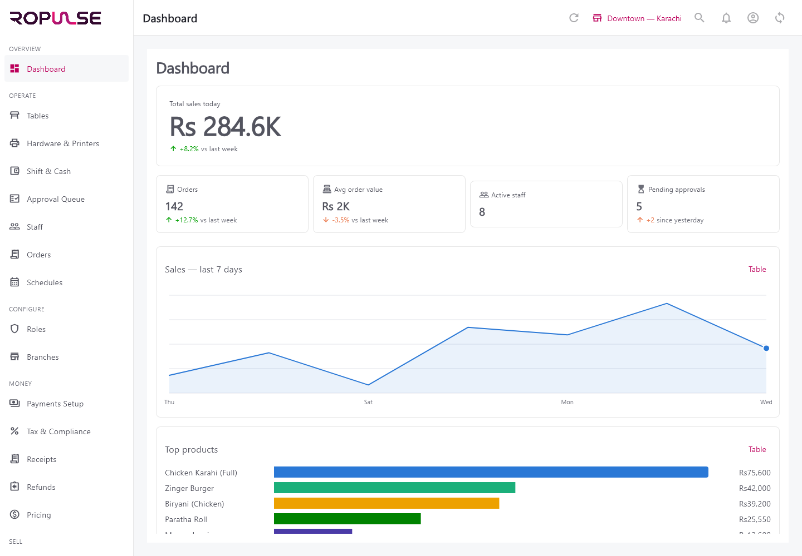

*Management workspace with a selected demonstration branch. Sales figures are seeded examples, not customer results.*

1. **Confirm the branch.** Check the selected branch before reading figures or changing settings.
2. **Read the headline figures.** Review sales and order context together; these are sample totals.
3. **Review the trend.** Check the chart period before comparing performance.

The Register is for taking orders, charging customers and producing receipts.
Backoffice is for products, branch setup, staff, payments configuration, reports
and administration. A permitted manager may see a control for switching between
them. Before switching, finish or deliberately hold an open order and save or
discard settings using the prompts provided. Switching areas does not settle
an order or close a shift.

Kitchen display availability depends on the release and kitchen setup supplied
to your branch. Do not assume that a kitchen screen is available merely because
the business uses kitchen printers. Ask your onboarding contact which workflow
the kitchen should use.

### Complete your first-day checks

For an owner, work through the setup route on the [help center home](user-guide/README.md).
For a cashier, check the branch, shift, visible products, payment methods and
printer status before serving the first customer. Ask the manager to explain
the permitted correction and approval process. Make sure you know how to find
the original order if a payment or print response is uncertain.

The expected result is an account that opens the correct area with the correct
branch and permitted actions. Missing screens can reflect permissions or
business type; a broken connection can also prevent the app from loading the
information it needs. Check the actual message rather than assuming that every
missing button means a subscription upgrade is required.

Continue with [business, branch and staff setup](user-guide/02-business-branches-and-staff.md)
or the [everyday Register workflow](user-guide/05-register-and-checkout.md).

---

## Business, branches & staff

Draft · confirm against the supported release, role and platform.

Use Backoffice for this work with an owner/manager account that has the relevant
staff, settings and branch permissions. Prepare the real names, contact details,
operating outlets and responsibilities before inviting people. A change can
affect one branch or the whole business, so confirm its scope before saving.

### Confirm the selected branch

Use the branch selection available to your account and check the branch name in
the page/header before editing. A branch-filtered report or payment policy will
not necessarily show the same data as another outlet. If a location is missing,
ask an authorized owner to check your branch access and whether the branch is
active. Do not create a duplicate outlet to bypass a visibility problem.

In **Branches** and the branch settings area, inspect the available business
profile, contact/address details, service settings, timezone and currency.
Restaurant and retail branches have different operating needs. Decide these
foundational values with the owner before recording real transactions; changing
a label is not a way to convert historical sales into a different currency or
timezone.

Keep tenant-wide settings separate from branch overrides. For example, one
branch may stop offering delivery while another continues it. A tenant-wide
product or payment-method change can affect multiple branches even when you
arrive at the page from a branch-specific view. Read the scope shown in each
form and check another branch after an intentional business-wide change.

### Add staff and prepare their access

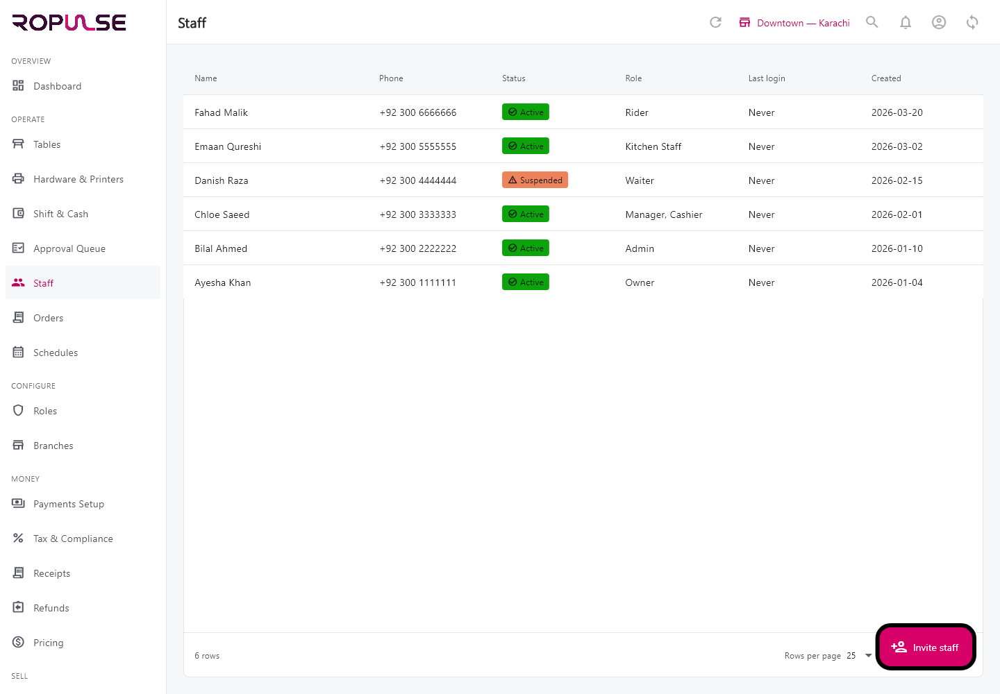

*Review the correct person and role before changing access. All names and contacts here are seeded demonstration records.*

1. **Check the staff record.** Verify the person, status and assigned role.
2. **Invite a staff member.** Use the invitation workflow and assign only the access needed.

1. Open **Staff** and search for the person before adding a record. Check names
   carefully so that you do not create an extra record for an existing worker.
2. Start the available add/invite action and enter the staff member's real
   identity/contact information required by the form.
3. Assign the intended role and authorized branches. A cashier usually needs
   sale actions, while management permissions should reflect actual duties.
4. Save/send the invitation and check the resulting status. Ask the staff member
   to accept the invitation and set their own credentials through that flow.
5. Have the staff member sign in on the prepared device and confirm the area,
   branch and actions they should see. Test a manager approval with a manager's
   own account rather than sharing that account's PIN.

If delivery of an invitation fails, inspect the existing record and retry or
replace the invitation using the supported action. Do not add the person again
without checking whether the first save succeeded.

### Use roles and permissions deliberately

Open **Roles** to review the available role settings with an authorized account.
Think in tasks: who may edit prices, issue a refund, manage staff, view reports,
or approve a write-off? Grant the permissions needed for those tasks and verify
the result using the actual staff account. Hiding a menu item is not a reason
to grant broad administrator rights.

A request can still be refused after a screen opens. The system checks the
operation itself as well as the visible navigation. When access is denied,
record the task and displayed message, then ask the owner to decide whether
the permission is appropriate. Do not teach staff to use another person's login
to work around a denial.

### Prepare schedules and access requests

Where your business uses schedules, open **Schedules**, select the relevant
branch/person and enter the intended working time through the available form.
Check the dates and branch timezone before saving. Review the saved schedule
with the staff member, especially when a shift spans midnight.

If a staff member receives a schedule mismatch at sign-in, they can submit an
access request where the screen offers it. A manager should open the staff
access-request area, inspect the person, branch and reason, then approve or
deny through the provided controls. An approval is a recorded exception, not
permission to share a login or ignore future schedules.

Web access settings may also restrict when a person can use management access.
Check the individual staff policy when a worker can use a prepared Register
but cannot access administration. Biometric enrollment, where supported, must
be performed through the authorized staff/device workflow and should be tested
on the same supported reader; it does not grant extra role permissions.

### Review approvals and account changes

The **Approval Queue** and specialist approval views bring together actions
that require a manager's decision. Open the request, confirm the original
order/person and requested amount or change, read the reason, and approve or
reject once. Tell the requesting staff member to continue through the original
workflow after the decision; approving a request is not always the final sale
or refund action itself.

When a worker leaves or changes duties, use the supported access/status and
branch-assignment controls. Preserve historical records rather than replacing
the worker's name with someone else's. Review their permissions and any pending
requests, then verify that the intended new access state has taken effect.

For your own account, use **Profile** and **Change password** where available.
Save the change and confirm the result. Business-wide configuration belongs in
**Settings** or **System Settings**, not in another staff member's profile.

Continue with [products and Register layout](user-guide/03-products-modifiers-and-layouts.md).

---

## Products, modifiers & layouts

Draft · confirm against the supported release, role and platform.

Use **Menu & Products** in Backoffice to maintain what the business sells. You
need the relevant catalog permission and the correct branch selected. Before
starting, prepare product names, categories, units, barcodes where relevant,
images, selling prices and the options customers may choose. A product record,
a selling price and a visible Register tile are related but separate settings.

### Organize categories and products

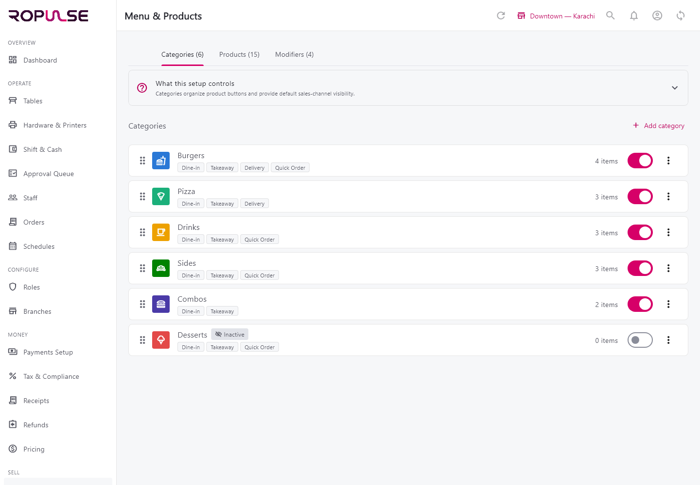

*Catalog configuration happens in Backoffice. Categories, Products and Modifiers have separate tabs.*

1. **Choose a setup tab.** Categories organize the catalog; Products and Modifiers manage their own records.
2. **Add a category.** Create a clear category before organizing its products.
3. **Check availability.** Read the sales-channel labels and active switch for the intended category.

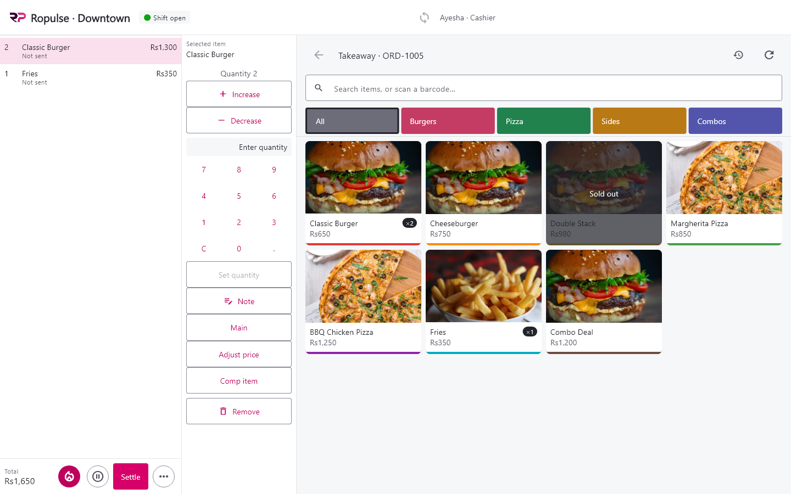

*Register example: categories, product photos and prices after configuration. This is the selling screen, not the Backoffice editor.*

1. **Find a product.** Use the product search or choose a category.
2. **Add the item.** Select a product and check any required choices.
3. **Review the running order.** Confirm quantities, options and the total before charging.

Create a small, sensible category structure before entering the full menu. A
restaurant might use Main dishes, Drinks and Desserts; a retailer might use
Grocery and Household. Use categories that staff can recognize quickly and
that will make sense when you review sales. Avoid creating several near-identical
categories to work around an item that is missing from the Register.

1. Open **Menu & Products**, review the existing categories, and use the category
   add/edit action where needed. Check the parent/category relationship shown
   by the form before saving.
2. Start the product form and enter its name and the identifiers your operation
   uses. For retail, check the barcode/SKU against the physical product; two
   different products should not accidentally share one scan identifier.
3. Assign the appropriate category and configure the available product type,
   variants, units, tax associations, and applicable order types.
4. Add a supported image if useful. A clear image can help staff distinguish
   similar dishes, but an uploaded picture does not change the selling price.
   Follow the upload validation shown by the form rather than renaming a file
   extension to bypass an unsupported image format.
5. Save and reopen the product to check the stored result. Complete its branch
   availability and active price before testing it in the Register.

Variants distinguish versions of a product, such as size or packaging. Review
which identifier, price and stock unit applies to each version. A label such as
“Large” must represent the actual variant the cashier should sell; changing a
visible tile label alone does not change the underlying variant.

### Configure modifiers and combinations

Modifiers represent choices attached to a product, such as an extra topping or
a sauce. A modifier group may require a minimum number of choices and impose a
maximum. Decide whether the customer must choose, whether additional choices
cost extra, and which products should offer the group.

Open the modifier-group area, create or edit the group, add the relevant options,
and set the available selection rules and option prices. Attach the group to
the product through the catalog workflow. Then test the product in the Register:
the selection sheet should prevent an incomplete required choice and show the
price effect before the item is added.

For example, “Choose a side” might require one option, while “Extra sauces” may
allow zero to two. Do not make a zero-choice optional group mandatory merely
to display it on screen. If the product is a combo, review its slots and the
eligible products/variants for each slot. A cashier should be able to complete
every required slot without selecting an unavailable item.

The expected result is a cart line containing the chosen product and its actual
options. A free-text note such as “add cheese” is not a substitute for a priced
modifier when the business charges for that extra.

### Control branch and order-type availability

Check branch overrides when one outlet should hide a product or use different
selling settings. Distinguish a change to the shared product from a branch-only
override. Likewise, a product may be offered for takeaway but not delivery.
The Register's applicable order type and branch rules decide what staff see.

If an item appears in the catalog but not on the Register, check its active
status, branch visibility, order-type applicability, active price, category
placement and published layout. Do not create a second product as the first
troubleshooting step; that can split sales and stock history.

### Publish a usable Register layout

Open **POS Layouts** for the selected branch. Choose the supported presentation
and orientation, organize categories, and add the product tiles your staff need.
Use meaningful labels and ordering. If custom colors or images are available,
use them to aid recognition without making the label unreadable.

1. Add or rearrange the intended categories and tiles in the designer.
2. Select the correct product/variant for each tile and check its visibility
   for the relevant order types.
3. Preview the intended device orientation and view mode. Keep essential order
   actions reachable rather than filling every available area with products.
4. Save/publish using the designer's available action and wait for confirmation.
5. Open the actual Register for that branch, refresh/reconnect through its
   supported flow, and test the tile, modifier choices and price.

A published layout is shared operating configuration. It is not a local cashier
preference and it does not guarantee an offline device has already received
the latest version. Have the manager confirm that affected Registers can see
the update before announcing a new menu to customers.

When import/export is available, review the provided format before importing a
large catalog. Start with a small representative set and inspect categories,
identifiers and prices afterwards. Exported product data should be handled as
business information. For ingredients and recipes, continue with
[stock and recipes](user-guide/09-stock-ingredients-and-recipes.md).

---

## Prices, taxes & payment setup

Draft · confirm against the supported release, role and platform.

This guide is for owners and managers preparing how sales are calculated and
recorded. Use the correct branch and the relevant pricing, payment and tax
permissions. Have your approved price list, base currency, applicable tax
instructions and accepted payment procedures ready. Your accountant or
responsible manager should approve tax treatment before real sales begin.

### Set and check selling prices

Open **Pricing** and select the relevant branch, products and pricing context.
Enter the intended amount and review any effective-date, variant and order-type
settings offered by the form. If the change needs approval, complete that
workflow rather than assuming that a submitted request is already active.
Bulk pricing helps apply a deliberate change across a selection; check the
selection and preview before saving so unrelated products are not changed.

After saving, test the product in the Register for the same branch and order
type. Check the amount displayed before and after modifiers and relevant
charges. A product with no usable active price may be unavailable for sale.
Publishing its tile does not create that price.

For example, a drink may have different dine-in and takeaway pricing. Check
both sale contexts rather than testing one and assuming the other is identical.
An old receipt retains its sale-time values; changing today's price is not a
correction to yesterday's invoice. Use the authorized correction workflow for
an incorrect recorded sale.

### Understand base currency and foreign tender

The branch's base currency is the currency in which its sale is calculated.
Foreign tender is money accepted in another configured currency and converted
under the branch's supported rate policy. Check the base currency and precision
before trading; changing a currency symbol does not convert stored amounts.

In **Payments Setup**, use the foreign-currency rate area to inspect or set a
supported rate. Read the conversion direction and units shown by the form.
When fixed/live modes are offered, choose the mode your business has approved
and review its effective time. Do not guess that a typed rate is the inverse
of the rate the app expects.

Test a small transaction with the expected conversion and inspect the displayed
base amount, tender amount and receipt evidence. Reports may contain different
currencies. Read the currency label beside each amount rather than adding rows
with different units. A missing-currency message needs investigation; it is not
an instruction to assume the amount is PKR.

### Configure tax and charges in their proper scope

Open **Tax & Compliance** to review the tax setup exposed for your account and
branch. Confirm product/category assignments, branch authorities and supported
rules with the responsible manager. Payment-related tax assignments belong to
the payment setup workflow where available. Service, delivery and packaging
charges are separate operating settings and should be reviewed with their
applicable order type.

Test the complete order rather than only the tax percentage field. Inspect
the subtotal, discounts, service/delivery charges, tax and final due amount.
The receipt should explain the result that was actually settled. A tax setup
screen does not by itself prove that an external fiscal service is connected;
use only the fiscal features explicitly enabled for your release.

### Prepare accepted payment methods

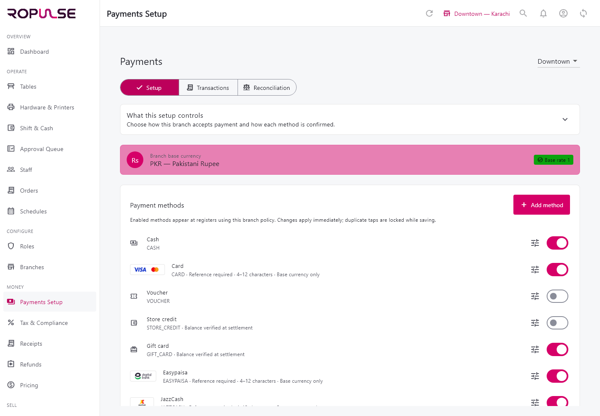

*Configuration example only. Enabled methods and provider logos do not prove automatic payment processing or provider approval.*

1. **Check branch and currency.** Verify the branch and its base currency before changing payment settings.
2. **Review enabled methods.** Use each method’s settings and switch deliberately. A visible logo does not confirm an automatic provider integration.

Open **Payments Setup** and use **Setup** to review the effective methods.
Decide which are accepted, at which branches, and which evidence staff must
enter. A method such as bank transfer, card or wallet can be recorded manually;
its presence does not establish an automatic connection to a bank or provider.
Tell cashiers exactly how they should verify receipt of money outside RoPulse.

For custom manual methods in a release where they are enabled:

1. Select **Add method** and enter a clear business name, such as “Business bank
   transfer”. Choose the appropriate category and display order.
2. Choose the offered reference mode: not required, optional, or required. For
   methods that collect a reference, provide a meaningful field label/help text
   and the permitted length and character rules.
3. Configure the selected branch's availability and accepted currencies. Check
   any tax associations in the related setup workflow.
4. Save and wait for the full result. Creation can include more than one setup
   step; an “incomplete setup” message must be resolved before the method is
   considered ready for cashiers.
5. Reload the effective method list and verify the method in the Register.
   Test both an acceptable reference and a value that should be refused.

Some built-in methods enforce mandatory evidence and cannot be edited or
archived through the custom-method controls. Respect the effective rule shown
by the app instead of assuming the owner's custom-method choice applies to
every built-in wallet or card method.

Tenant availability and branch availability are separate. A branch policy
cannot make a method usable while it is disabled for the business. Likewise,
enabling something business-wide can affect more than the currently selected
branch. Review the displayed scope and confirm the intended result at each
affected outlet.

If saving fails after a method has been created, inspect the disabled/incomplete
record and finish it through the edit workflow. Do not repeatedly add new
methods with slightly different names. When a method is no longer accepted,
disable/archive it through the supported action; its old transaction history
should remain readable with the original method name.

### Promotions and approval

Use **Promotions** to configure supported offers/coupons and their eligibility,
dates and scope. Test a qualifying and nonqualifying cart. An advertised discount
must match the actual branch/order conditions. Manual price overrides and
discounts may need a manager's permission or reason; configuration is not a
substitute for that approval.

The expected setup result is a cashier who sees only intended payment options,
understands the required evidence, and produces the expected total and receipt.
Continue with [Register and checkout](user-guide/05-register-and-checkout.md).

---

## Register & checkout

Draft · confirm against the supported release, role and platform.

Use this guide after the device, branch, products, prices and payment methods
have been prepared. Sign in with your own staff account and follow your
business's shift-opening procedure. Before serving a customer, check the branch
and working shift shown in the Register. Screen layout changes with device
size, but the same order and payment checks apply.

### Start the correct kind of order

At the Register's order-type selection, choose the branch-enabled service you
are actually providing. Dine-in may ask for a table, takeaway can collect
customer details, and delivery needs the relevant contact/delivery information.
A retail branch uses its supported counter-sale flow. Only use order types
provided by the released app and enabled for this branch.

Check table/customer/context before adding items. A delivery customer's phone
can trigger a blacklist warning or block. Follow the manager's permitted
override process where one is offered; do not enter another person's number
to hide the restriction. Selecting the right order type matters because
availability, charges and pricing may depend on it.

### Add products and choices

*The running order is on the left, item quantity controls in the middle, and the product catalog on the right.*

1. **Find a product.** Use the product search or choose a category.
2. **Add the item.** Select a product and check any required choices.
3. **Review the running order.** Confirm quantities, options and the total before charging.

1. Select a category or search for the product. Retail staff can use a supported
   keyboard-wedge scanner through the relevant search/scan field.
2. Select the intended product and variant. Where an options sheet opens,
   complete required combo slots and modifier choices before adding the item.
3. For a supported weighted product, enter/confirm the actual weight and unit.
   Do not treat weight as the count of packages.
4. Review the new cart line: name, chosen options, quantity and amount. In retail,
   repeated scans may increase the quantity of the existing product line.
5. Repeat until the customer's order is complete, then read the full cart back
   or show the customer display where your branch uses one.

If an item has no active price or is not available, follow the displayed
message and contact the manager. Typing a note or choosing a similarly named
product is not a valid substitute for the unavailable item.

### Review and correct an open cart

Use the quantity controls to change the intended number of items, then check
the resulting total. Add a preparation note where supported, such as “no
onions”. A note does not add a priced extra and should not replace the proper
modifier selection.

Use the available void/remove action for an incorrect item, following any reason
and approval requirement. A complimentary item and a void are different business
events; ask the manager which applies. Check service/delivery charges and
discounts before moving to payment. The final displayed total must agree with
what you intend to charge, including the applicable pricing context.

Changing an order type can change prices and eligibility. If the app offers
that action, read the result and review every affected item before proceeding.
Do not assume the old total remains valid after switching service types.

### Hold and resume an order

Use **Hold** when a legitimate open order should be continued later. Wait for
the confirmation and confirm the Register has returned to the expected state.
Holding is not payment and should not be used to conceal an abandoned order.

Open **Held orders**, find the order by its reference/context and resume it.
Check its items and owner before adding more products. Your permissions may
restrict recalling another person's order; request authorized help rather than
creating another copy. If resume returns an uncertain connection response,
check the original order state before starting a replacement.

### Link a customer and repeat an earlier order

Where the customer picker is available, search by phone, name or email and
select the correct person. Check the contact details to avoid attributing one
customer's purchase to someone with a similar name. If no match exists and
your permissions allow it, create the customer through the provided form.
An unlinked walk-in remains appropriate where the service flow permits it.

The customer's recent orders can help a repeat purchase. Use **Repeat** on the
intended original order when offered, then review the new preview. Current
prices, taxes and availability apply; the old total is not a price guarantee.
Read warnings about missing products/modifiers or expired preview conditions.
Confirm only when the customer accepts the current result.

If repeat confirmation is pending or its outcome is uncertain, use the provided
recovery/retry path for that original request. Do not click repeat again as a
new operation or create an ordinary replacement sale while recovery is pending.
This can create two orders for one intention.

### Charge and settle

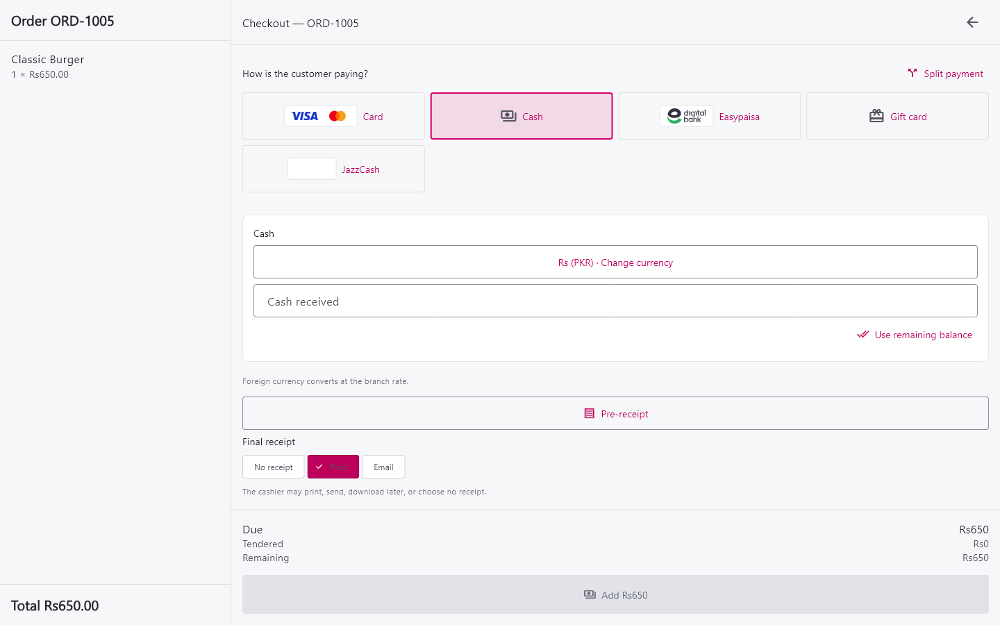

*Cash is selected, Rs650 is due, and no tender has been added. Method logos do not establish automatic provider processing.*

1. **Choose the payment method.** Confirm the method matches the money actually received.
2. **Enter the amount.** Check the cash amount before adding the tender.
3. **Check the remaining balance.** Read Due, Tendered and Remaining before completing the sale.

Select **Charge**, read the due amount and choose the effective payment method.
Enter the amount, currency and any required external reference. Add multiple
tender lines only when the customer is intentionally splitting payment; check
the remaining due and any cash change. For a manually recorded bank/card/wallet
payment, follow the business's independent confirmation procedure first.

Press **Settle** once and wait for the outcome. On success, inspect the completed
sale and invoice/receipt reference before starting a new order. Follow the
available print/digital receipt options and return the correct cash change.
If the response is lost or uncertain, investigate the original payment/order;
do not collect the customer's money or settle a second time just because the
confirmation screen did not load.

Finish any required kitchen/service step through your branch's restaurant
workflow. Settling a payment, printing a receipt and sending a kitchen ticket
are separate actions with separate results. Read
[payments, receipts and corrections](user-guide/07-payments-receipts-and-corrections.md)
for the detailed tender and recovery process.

### Register on a smaller screen

The Register adapts to the available space. Check the selected branch and order reference, and review the cart before charging. Panel placement can differ from the desktop example. Confirm that your installed release supports the intended device.

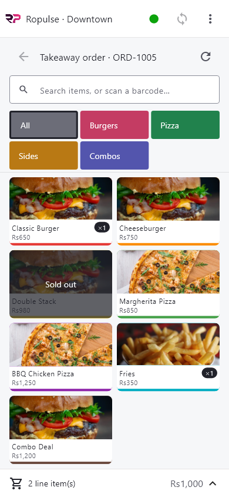

*Actual Register at phone width. These are sample products and orders.*

1. **Search the catalog.** Find the required item or use the category buttons.
2. **Select an item.** Review its price and required choices.
3. **Open the cart.** Review the complete order before checkout.

---

## Restaurant service & kitchen

Draft · confirm against the supported release, role and platform.

This guide is for restaurant managers, waiters and cashiers using the enabled
dine-in, takeaway or delivery flows. The manager should prepare tables, service
settings, modifiers, courses and kitchen routing before service begins. Kitchen
printing and a kitchen display are separate supported setups; confirm which
one the branch actually uses.

### Prepare service and tables

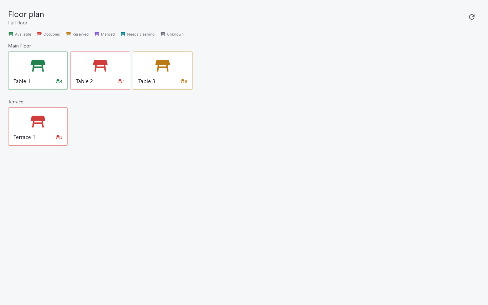

*Table names, seating and status help staff identify the service context. These are demonstration tables.*

1. **Read table status.** Use the status legend to distinguish available, occupied and reserved tables.
2. **Choose the correct table.** Confirm the table name and service context before adding an order.
3. **Check the service area.** Confirm whether the table belongs to the main floor or another area, such as the terrace.

In Backoffice, review **Order Types**, branch service settings and **Tables**.
Enable only the services the branch can fulfil. Counter service and waiter
service may use different operating procedures. Check delivery enablement,
supported payment modes and any delivery/packaging charges, then test the
result in a real Register order context.

In **Tables**, maintain the floor layout and table records using the available
controls. Give tables clear, unique names that staff can find quickly. Make
sure the floor plan represents actual seating and that the waiter can identify
which table has the customer. A layout picture alone does not move an existing
order to another table.

For a dine-in order, select the correct table when the branch's workflow asks
for one, confirm the guest/context information and add the products. Check the
active order reference when returning to an occupied table, especially if
several staff serve the same area. Starting a second order should be a deliberate
decision, not a workaround for failing to find the original table order.

### Use courses, modifiers and preparation notes

Complete required modifier choices before adding the dish. Use a note for
preparation information that is not represented by a priced option. Make sure
the note communicates the kitchen instruction clearly without replacing an
allergen or product-safety process established by your business.

Where courses are enabled, assign the appropriate course to each line, such
as starters, mains or desserts. The manager maintains course options through
the related branch setup. Before firing, review which lines and courses are
ready. Sending everything immediately may be inappropriate when a guest
expects starters and mains at different times.

### Send an order to the kitchen

1. Confirm the table/order and review the products, options, quantities and
   notes. Correct errors through the permitted cart controls first.
2. Select **Fire to kitchen** and inspect the course/round selection offered.
3. Send the intended course or all eligible courses and wait for confirmation.
4. Check the recorded round/history and kitchen/print state. Confirm physical
   receipt in the preparation area through the branch's agreed service process.
5. For additional items ordered later, add them to the correct order and send
   the intended next round; do not recreate the already-sent round.

A recorded kitchen request and paper emerging from a printer are different
events. If the status is pending, failed or uncertain, investigate the original
job rather than repeatedly firing the order. A duplicate ticket can cause the
kitchen to prepare food twice. Manager reprint/recovery should preserve the
reference and indicate the reason for the extra copy.

### Move, merge or split a table/bill

Use the table/floor plan's available actions with the required permission.
Before transferring, confirm the source and destination and whether either has
another active order. After completing the action, inspect both tables and the
order's items. Staff should be able to identify where the guests and bill now
belong.

For bill splitting, choose the supported item/person method from the open order
and inspect each resulting amount. Confirm that items are assigned as intended,
charges/tax are accounted for and the remaining original balance makes sense.
A split bill is not a second independent copy of the same unpaid items. If an
action is unavailable or refused, ask a manager to inspect the order state and
permissions rather than settling unrelated replacement orders.

Use a needs-cleaning/available table status only through the branch's supported
table workflow. A payment can be complete while the physical table is not yet
ready for new guests; communicate that operational difference to the floor team.

### Handle takeaway and delivery

For takeaway, check the customer/name reference and use the displayed token or
other agreed pickup signal. Use **Mark ready** where offered when the order
is actually ready. A “notify customer” action may record a dispatch request;
only a confirmed supported delivery status establishes whether an external
message was sent or delivered. Do not promise an SMS or WhatsApp notification
merely because a button was pressed.

For delivery, select the correct customer, verify contact and destination
details, record delivery notes and use a rider assignment only where supported.
Review whether the order is cash-on-delivery or prepaid under the branch's
configuration. Verify external prepaid money using the business's procedure;
selecting a prepaid label does not perform a transfer. Follow any blacklist
and approval warning before dispatch.

At the end of service, review open/held/table orders and unresolved kitchen jobs
with the next shift or manager. A clean screen is not proof that every guest
has paid or that every preparation request has been fulfilled.

---

## Payments, receipts & corrections

Draft · confirm against the supported release, role and platform.

This guide is for cashiers and authorized managers. Your branch must have
approved payment methods, tax/charge rules and receipt setup. Financial
corrections may need permissions, a reason, manager approval and the original
payment or invoice. Never create another sale as a shortcut for investigating
an uncertain payment.

### Cash and split tender

*Read Due, Tendered and Remaining before completing payment. This example is unpaid; it does not show a completed provider transaction.*

1. **Choose the payment method.** Confirm the method matches the money actually received.
2. **Enter the amount.** Check the cash amount before adding the tender.
3. **Check the remaining balance.** Read Due, Tendered and Remaining before completing the sale.

Open the payment sheet from the intended order and read the total due. Select
**Cash**, enter the amount actually received, and check the displayed change.
For example, if the total is 1,850 in the branch currency and the customer gives
2,000, verify that the change is 150 before completing the sale. A permitted
cash-drawer action depends on its configured hardware; a successful sale is
not proof that the drawer physically opened.

When a customer deliberately uses more than one method, add each tender line
with its actual amount and check the remaining due. A 600 cash payment and a
400 manually confirmed transfer cover a 1,000 bill only when the effective
charges and conversion also agree. Do not add a second payment just to make a
pending response disappear. Check the final payment breakdown before settling.

### Manually recorded card, wallet and transfer payments

*Check whether a method is manually recorded or integrated in your actual release. This fixture makes no provider certification claim.*

1. **Check branch and currency.** Verify the branch and its base currency before changing payment settings.
2. **Review enabled methods.** Use each method’s settings and switch deliberately. A visible logo does not confirm an automatic provider integration.

Methods named Card, bank transfer, Easypaisa, JazzCash or a custom name may use
manual confirmation in your release. Staff confirm the payment through the
business's approved external process, then record it in RoPulse. A payer's
claim, typed reference or screenshot is not equivalent to verified receipt of
funds in the business account.

1. Confirm the external payment through the procedure supplied by your manager.
2. Select the matching effective method and enter the actual amount/currency.
3. Enter the required reference exactly. Read the configured length/character
   guidance and do not substitute a made-up value if validation fails.
4. Check any remaining due and method-dependent calculation, then settle once.
5. Inspect the completed order/payment result and preserve the original reference
   if a manager needs to reconcile it later.

Some custom methods have optional references; supplied optional values can
still be validated. Built-in methods may enforce a required reference. Ask a
manager to fix an incorrect policy instead of entering meaningless evidence.

Foreign tender must use the selected currency and the displayed conversion
rules. Read both tender and base amounts; the number of currency units given
is not interchangeable with the branch-currency amount recorded on the sale.

### Confirm payment before issuing the final receipt

After **Settle**, wait for the recorded success state and invoice reference.
If the connection fails during settlement, preserve the order and investigate
its state. Ask the manager to check the original order/payment transaction.
Taking payment again or starting a second invoice can duplicate the customer's
charge even if the first response never reached the screen.

The receipt is the document for the recorded sale. A pre-receipt or bill preview
can show an amount still due; it is not confirmation that the customer has paid.
Invoice numbers, order references and takeaway tokens serve different purposes.
Use the correct reference when handling a complaint or retrieving a document.

### Configure and retrieve receipts

Authorized managers use **Receipts** in Backoffice to review receipt setup,
scope, sections, language/messages, output defaults and publish checks. Check
whether you are editing the business default or a branch override. Preview a
representative restaurant or retail receipt before publishing, then print a
test on the real supported printer. A sample preview is useful for layout;
inspect an actual settled document to verify the sale's real values.

Use receipt history to find the original by its reference/date and available
filters. Open the stored document to inspect its sale-time items, totals and
payments. Use the supported output actions, such as a PDF download, authorized
reprint or enabled email receipt. A reprint remains a copy of the original
record; do not edit today's product settings to try to change it.

Read digital delivery status separately from the sale result. Queued, sent,
delivered and failed are different states. If email is unavailable, use the
supported print/PDF path and resolve channel setup with the manager. Do not
promise that unsupported SMS or WhatsApp delivery occurred.

### Void, complimentary item, refund and reversal

A void concerns an item/order action and can include a write-off decision. A
complimentary item records the business intentionally not charging the guest
under the supported restaurant flow. A refund returns value against a recorded
sale. A payment reversal relates to the original payment. These actions are
not interchangeable ways to reduce a report total.

For an open-order void, select the correct item, read the available void/write-off
choice, enter an accurate reason and obtain any required approval. When an
approval is requested, wait for a manager's decision and continue the original
action through its retry/complete control. Do not remove another item just to
make the total look right while waiting.

For a settled-sale refund or payment reversal, open the original order/invoice
or relevant refund/payment view. Confirm the products, remaining refundable
amount, original method, intended destination and reason. Submit through the
provided workflow and inspect its result. A request awaiting approval is not a
completed refund; an application record does not automatically prove a bank
has returned money through an external manual method.

Retail exchanges may combine a return and a replacement purchase under the
supported flow. Review the net difference and stock/credit result, and do not
assume an ordinary refund duplicates all exchange behavior. Follow the branch's
approved return policy and escalate an unavailable action.

### Investigate and reconcile

Managers can use **Payments Setup → Transactions** to inspect recorded payment
history and available exports. Use **Reconciliation** with the required access
to compare expected activity and supporting external/bank records. Match the
original order/invoice, method, currency, reference and amount; a similar amount
on the same day is not sufficient identification.

Preserve history and reasons when correcting a mismatch. If the app reports a
duplicate reference, conflicting state or already-processed action, inspect the
existing record before retrying. Continue with
[shifts and reporting](user-guide/10-shifts-reports-and-audit.md) for closing checks.

### Checkout on a smaller screen

Payment controls move to fit the device. Follow the on-screen steps and review the original order and remaining amount before settling. A smaller layout does not change the need to verify money and avoid duplicate requests.

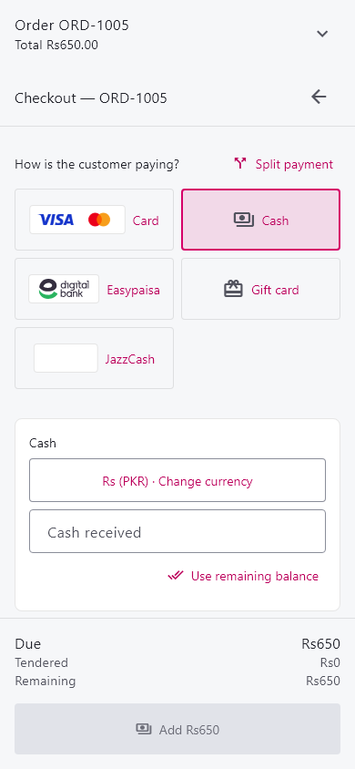

*Compact cash tender example. No money has been collected in this demonstration.*

1. **Choose the method.** Confirm the selected tender matches the money received.
2. **Enter the cash received.** Check the amount before adding the tender.
3. **Read the balance.** Check Due, Tendered and Remaining before completing payment.

---

## Customers & loyalty

Draft · confirm against the supported release, role and platform.

Use these tools to associate sales with the right customer and manage the
engagement features enabled for your business. You need the relevant customer,
loyalty, gift-card, campaign or refund permissions. Handle contact information
according to your business's consent and privacy procedures.

### Find and maintain the right customer

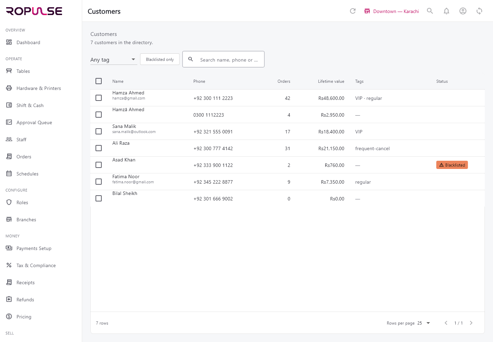

*Compare identifying details before selecting or merging records. Names, phone numbers and emails shown are seeded app fixtures.*

1. **Find the correct person.** Search and compare identifying details before selecting a record.
2. **Compare history and tags.** Check order history, value and tags to distinguish similar records.

Open **Customers** and search by the supported identifiers, such as name,
phone or email. Check contact details before opening or selecting a record.
Use the detail view to review available order history, saved addresses, notes,
tags and customer status. A customer's name alone is not a reliable match.

For a new customer, use the available create form and enter genuine details.
Use permitted profile edits for corrections and save changes deliberately.
When the same person has duplicate records, the authorized merge workflow is
the appropriate way to combine them. Inspect both records and choose the
surviving identity carefully. Do not merge two different people because they
share a contact number, and do not replace one person's identity with another
person to reuse a balance or history.

Staff-visible notes should help service without exposing unnecessary sensitive
information. A delivery blacklist setting can restrict new delivery orders;
record a justified reason and check the effect before relying on it. A
blacklist is not a substitute for accurately recording the customer involved
in an existing sale or complaint.

### Use customer history at the Register

Select the customer through the Register's customer picker where supported.
The recent-order list can show the customer's earlier purchases and sale-time
currency. Read the currency label with each total. An older order with missing
currency information should not be guessed to be in the current branch currency.

When repeating an order, inspect the current preview and availability warnings.
An earlier purchase is a starting selection, not an agreement to keep its old
prices or discontinued options. Confirm the new result with the customer and
use the original recovery flow if confirmation is uncertain.

### Set up and use loyalty

In **Loyalty**, an authorized manager can review the earning rules and use
customer lookup/history. Set the offered earning rates according to the
business's published program, save, and test a representative sale. If a rule
or redemption option is unavailable for the installed release, do not promise
it to customers based on a visible future setting.

At checkout, select the correct customer and use the supported points redemption
control. Review the available balance and the actual effect on the due amount
before settlement. Redeemed points and earned points are different movements;
check the resulting history when resolving a customer question.

Manual credit/debit actions, where permitted in Backoffice, require the business's
authorization and an accurate reason. Record the intended adjustment once and
inspect the balance/history afterwards. Do not issue new points merely because
a prior request timed out; check whether the original adjustment succeeded.

### Gift cards and store credit

In **Gift Cards**, the denomination catalog defines the values available for
issue. Managers with the relevant permission can maintain denominations and
inspect issued-card status. Before using **Issue gift card**, read what that
operation means in the released app: complimentary/administrative issuance can
create a funded liability immediately. It must not be treated as proof that a
customer paid for a card.

For authorized administrative issuance, choose the intended denomination,
optionally associate the correct customer, submit once and record the returned
code/status. Store and disclose the code through the business's approved
procedure. If paid gift-card sales are enabled separately in your release,
follow that explicit sale/payment workflow; do not improvise a paid sale using
a complimentary issuance action.

At the Register, use the supported gift-card redemption control, enter the code
and inspect its usable balance/status. Apply only the intended amount and
review the remaining bill. For example, redeeming 1,500 from a valid 5,000 card
leaves 3,500 only after the recorded transaction completes successfully. Check
the actual balance after an uncertain response before trying again.

Store credit belongs to a customer and is commonly created by a supported
refund process; it is not the same as a transferable gift-card code. Select the
correct customer and inspect the available credit/ledger before applying it.
Expired, cancelled, depleted or otherwise unavailable balances must follow the
displayed rule and the business's authorized resolution procedure.

### Campaigns and customer messages

Open **Campaigns** to create/manage the campaigns supported by your account.
Choose the intended audience, channel, message and immediate/scheduled timing.
Review the recipient selection and any required provider readiness before
starting a send. Use only contacts the business is permitted to message.

A draft, scheduled campaign and externally delivered message are distinct
states. Inspect the reported status and errors rather than treating a saved
campaign as a completed delivery. Provider configuration, usage allowances or
channel availability can limit what the business can send. Do not export a
customer list into an unrelated service to bypass those controls.

### Resolve feedback and complaints

Use **Feedback** to review the rating/complaint, its source and linked order
where available. Read the original transaction before deciding on a response.
Record the supported resolution/status and an appropriate note, then verify
that the result saved. A complimentary item recorded during service and a
later complaint can relate to the same order but remain different events.

Use the customer and order references when escalating a balance or complaint.
Do not send full gift-card codes, customer lists or unnecessary personal
information through an unapproved support channel.

---

## Stock, ingredients & recipes

Draft · confirm against the supported release, role and platform.

This guide is for authorized stock and catalog managers. Confirm the branch,
product and measurement unit before entering quantities. A retail product's
quantity on hand and a restaurant ingredient's recipe/cost are different
records. Use the workflow your business has enabled; do not assume that a stock
screen includes purchasing, supplier management or every inventory process.

### Read retail quantity on hand

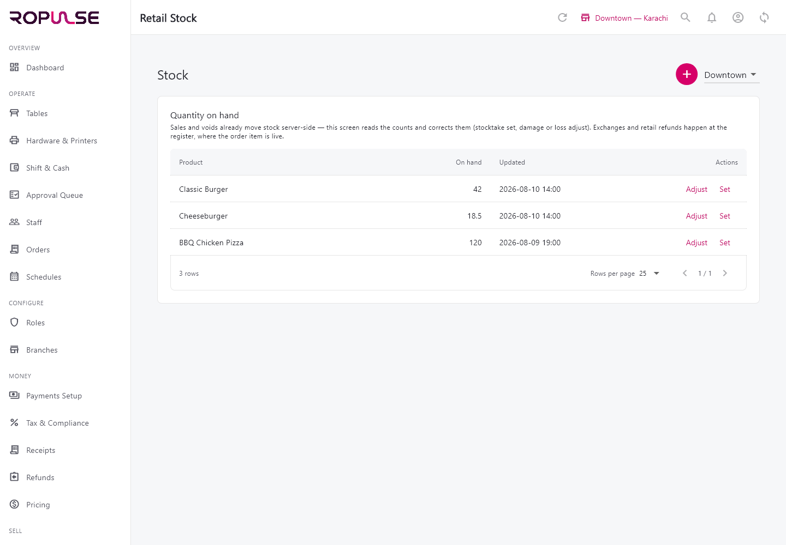

*Read the branch and product first. Adjust changes a quantity by a difference; Set records an absolute counted quantity.*

1. **Confirm the stock branch.** Stock quantities belong to the selected branch.
2. **Read quantity on hand.** Check the product, quantity and last update before making a correction.
3. **Choose Adjust or Set.** Adjust records a difference; Set records a counted total. Follow the matching instructions below.

Open **Retail Stock** for the intended retail branch. Find the product and read
its on-hand quantity and available update information. Check whether you are
looking at the correct product/variant and unit. A number of individual units
cannot be compared directly with a count of cartons without the business's
correct unit convention.

The expected value reflects recorded stock movements, not an automatic physical
count of the shelf. A difference can arise from unrecorded delivery, wastage,
wrong-product sale or incomplete reconciliation. Investigate the cause rather
than entering repeated corrections until the number looks familiar.

### Adjust stock by a difference

Use **Adjust** when you intend to record a change relative to the current
quantity. For example, adding 5 to a current quantity of 12 should produce 17
if no other movement intervenes. A negative adjustment can represent a supported
reduction under your business's approved process.

1. Select the correct product row and choose **Adjust**.
2. Enter the signed change in the unit expected by the form and an accurate
   reason where requested. Check the sign before submitting.
3. Save once and wait for confirmation. Reopen/refresh the product to inspect
   the resulting on-hand value.
4. If the response is uncertain, inspect the current value/history before
   entering the same movement again.

Do not use an adjustment to erase a legitimate sale or return. That sale's
financial correction belongs to the order/refund workflow.

### Set stock from a count

Use **Set**/**Set stock** when the business intends to record the absolute
counted quantity. Setting 17 means “the count is 17”, not “add 17”. Agree a
counting time and control sales/movements during the count so the physical
number and system action refer to the same stock position.

Count the product, check unit/variant, enter the final quantity and reason,
then save and inspect the result. If another person is also counting the same
product, coordinate before either person submits. A second absolute set can
overwrite the intended position of a later movement.

### Prepare restaurant ingredients

Use the ingredient/recipe area linked from the catalog. Create an ingredient
with the supported name, measurement unit and cost information. Keep units
consistent: a recipe using grams should not accidentally treat a kilogram cost
as a per-gram cost. Review ingredient details when purchase costs change, using
the business's approved cost-maintenance process.

Before adding a duplicate ingredient, search for an existing record with a
different spelling. Duplicate ingredients can split recipe costing and make
later review harder. Follow the available archive/edit policy instead of
reusing an old ingredient's identity for a different raw material.

### Build and check a recipe

Open the recipe list and select the intended product, or use the attach/build
action for a product without a recipe. Add the ingredient components and their
quantities in the expected units. Review the cost and any displayed comparison
with selling price/margin. Save, reopen and inspect the composition again.

For example, a recipe for one portion should describe that portion's ingredient
requirements. Do not enter a full batch quantity as a per-portion amount unless
the recipe form explicitly represents a batch/yield. Use the supported fields
and the business's agreed costing convention.

The missing-recipe filter helps identify products not yet covered. A product
without a recipe can still appear elsewhere in the catalog; it should not be
assumed to have a zero real cost. Recipe costing is not evidence that every
sale has already posted automatic ingredient consumption in the released
system. Confirm the enabled stock/consumption behavior with your onboarding
contact before relying on it for purchasing or waste decisions.

### Check a stock-related customer problem

If a cashier reports unexpected availability, compare the product's active and
branch availability settings with stock. A product can be hidden despite having
quantity, and an out-of-stock display may have a separate branch selling
policy. Use the actual message and selected branch to investigate.

Escalate with the product identifier/name, branch, expected and displayed
quantity, unit, approximate time and recent authorized actions. Avoid a
speculative series of adjustments; that makes the original difference harder
to trace.

---

## Shifts, reports & audit

Draft · confirm against the supported release, role and platform.

This guide is for staff handling a Register shift and managers responsible for
cash and operational review. Agree the physical cash-counting and handover
procedure before opening. Reports must be read with the right branch, date,
timezone and currency; a different selection can explain an apparent difference.

### Open a shift

Sign in on the correct prepared Register and open the shift control in its
header. If no shift is open, use the available **Clock in**/opening action.
Enter the actual opening cash where the form asks for it, along with any
required check-in information. Count the float rather than copying yesterday's
amount automatically.

Wait for the confirmed open state and inspect the shift shown in the header.
If a shift is already open unexpectedly, ask the responsible manager to inspect
it before creating or closing anything. The business may need to distinguish a
staff attendance action from a Register cash shift; follow the terminology and
records provided by your installed release.

### Record cash movements correctly

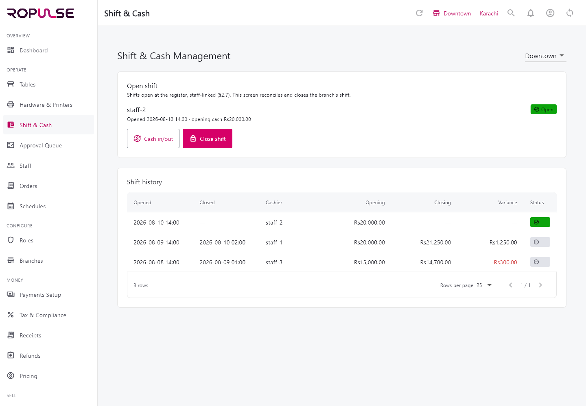

*This management screen reconciles and closes a branch shift. Opening the shift happens at the Register in the supported workflow.*

1. **Review the open shift.** Confirm the cashier, opening time and opening cash before recording a movement.
2. **Record cash or close carefully.** Use the appropriate action and reconcile the counted cash before closing.
3. **Investigate differences.** Review closing values and variances against the original shift records.

Sales, refunds and supported cash-drawer events contribute different types of
activity. Use the available cash movement action and an accurate reason for a
permitted non-sale event. Opening a drawer for inspection is not the same as
recording money added or removed. Do not create a fake sale to account for an
unrelated cash movement.

Keep physical supporting records according to the business's procedure. When
a manually recorded external payment is involved, its value should not be
counted as physical drawer cash simply because it was recorded at this Register.

### Close and hand over

1. Review open/held orders and any unresolved payments with the manager. Closing
   a shift should not hide an uncertain sale that still needs investigation.
2. Count the cash using the business's agreed method and identify any amounts
   that belong outside the drawer's expected sales/float calculation.
3. Open the shift closing action and enter the actual count and required notes.
4. Review expected versus counted values and any variance. If a discrepancy is
   real, record the explanation; do not change the count to force a zero variance.
5. Complete the permitted closing/approval flow and verify the recorded status.
   Pass unresolved issues and references to the next responsible person.

In Backoffice **Shift & Cash**, managers can open shift detail to review the
cash drawer, reconciliation, payment-method breakdown, cash events and handover
notes. Check sales, reversals and net figures in their proper context. An
external card terminal's bank settlement can include fees or different timing;
it should not be forced to equal a gross cash-drawer figure.

### Read the dashboard and reports

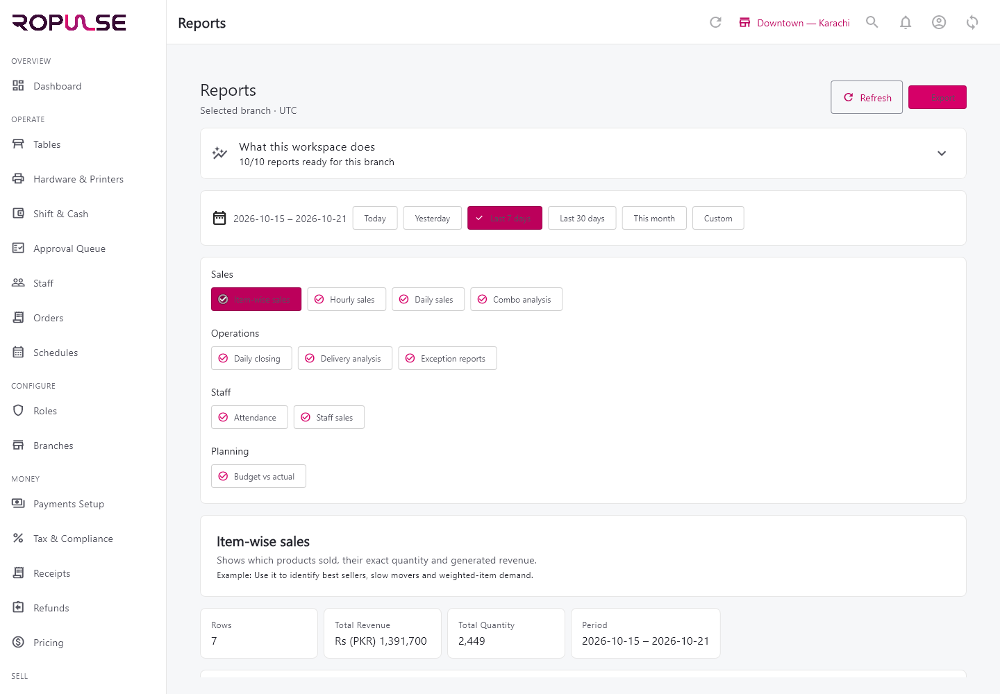

*Select the report, branch and period deliberately. This example displays UTC and uses sample records.*

1. **Choose the date range.** Confirm the period and displayed time zone before comparing numbers.
2. **Choose the report.** Select the report that answers the question you are investigating.
3. **Export the current selection.** Check the branch, report and period before exporting.

The **Dashboard** gives an overview such as sales indicators, trends, best-selling
products and exceptions where supported. Treat it as an entry point for
investigation. Use the underlying report/order/payment records for a detailed
reconciliation, and check whether the selected data finished loading.

In **Reports**, select the intended branch and period, then choose the relevant
report. The workspace includes supported views such as item/hour/day sales,
daily closing, budget comparisons, combo/delivery analysis, exceptions and
attendance. Read the available details and units before interpreting a total.

Reports can load independently. If one fails while another succeeds, use the
targeted retry for the failed report. A visible successful table is not evidence
that the complete report pack loaded. A date range that is too large may be
rejected; narrow it to the period you actually need.

Where budget entry is available, enter the intended branch-currency target and
date/context, save, and review the updated comparison. A target is a planning
figure, not an alteration to actual sales. When currencies differ, compare like
units; mixed-currency rows cannot automatically be added as one monetary total.

### Export data

Use **Columns** to choose the supported visible report details, then the
available **Export** action. Options include the current report as CSV/Excel
and a complete reports pack in one Excel sheet where supported. Confirm whether
the export contains your current selection or all requested reports.

If the app says some reports failed, retry them before calling an exported pack
complete. Inspect the resulting file's branch, dates, currency and totals. Store
exports securely: they can contain business performance and staff information.
Exporting a report is not a database backup.

### Use audit, void and approval history

Use **Void Log** to inspect voided activity with its reasons and linked order.
Use **Audit Log** to review the supported record of actions. Where anomaly
alerts appear, inspect the underlying records before concluding that someone
acted improperly; an alert is a reason to investigate, not a final finding.

For a discrepancy, begin with the original order or invoice reference and trace
its payment, correction, approval and shift context. Check the actor and time
alongside the amounts. Do not edit unrelated setup or delete records to make a
historical discrepancy disappear. Escalate with the relevant references and
the comparison you expected to match.

---

## Printers, receipts & KOT

Draft · confirm against the supported release, role and platform.

This guide explains what to install, how to connect a printer to the device running RoPulse, and how to check that customer receipts and kitchen order tickets reach the correct place. Complete setup on the actual till or print-station device that will be used during service. A printer working on a manager's laptop does not make it available automatically on every till.

You need a manager with hardware-management permission for branch printer records, routing and assignments. Cashiers may use the recovery and status actions allowed by their role. If an option is missing, ask a manager to check access rather than sharing another person's account.

### 1. Understand the two kinds of printing

| Output | What it does | What it does not mean |
| --- | --- | --- |
| Customer receipt | Shows the completed sale and its recorded payments. | Printing does not take a new payment. |
| Pre-receipt | Shows an unpaid, provisional bill for the customer to review. | It is not a paid receipt or tax invoice and does not settle the order. |
| Kitchen order ticket (KOT) | Tells a preparation area which items to make for an order and round. | It is not proof of payment. |
| PDF | Saves a document for viewing or supported system printing. | Saving a file does not prove that a physical printer produced paper. |

Receipt output and KOT routing are configured separately. A working receipt printer alone does not complete kitchen setup. KOT delivery needs all four links: a category routing rule, a logical kitchen printer, an assigned device that can process jobs, and a physical ESC/POS printer connection on that device.

### 2. Prepare before installation

Collect the printer's manufacturer and exact model, its supported connection type, paper width, the device operating system, and the printer's intended location. For a network printer, also obtain its IP address and configured printing port from the installer or printer configuration page.

Load the correct thermal paper with the printable side facing the print head, close the cover, connect power and run the printer's own self-test according to its manual. If that self-test is blank, incomplete or reports an error, resolve the printer problem before changing RoPulse settings.

Use the manufacturer-approved driver or setup utility for the exact model and operating system. Download it from the manufacturer's official support site or obtain it from your approved installer. There is no single driver that should be installed for every printer model.

#### What needs to be installed?

| Connection or output | Preparation on the printing device |
| --- | --- |
| Windows system printer / PDF printing | Install the model's Windows driver when required, add the printer in Windows, and print a Windows test page. Select the matching printer in RoPulse. |
| Windows RAW ESC/POS | Set up a Windows printer queue for a compatible ESC/POS thermal printer. The printer and queue must accept raw ESC/POS bytes; an ordinary office or PDF queue is not a substitute. Confirm the printer is offered through the supported RoPulse transport before binding it for KOT. |
| Network ESC/POS | Configure the printer's network connection and address, and use a compatible native RoPulse app on a device that can reach it. Direct network printing does not itself require a Windows system queue. A vendor utility may be needed to configure the printer. |
| Android USB ESC/POS | Use a supported Android device, compatible USB printer and a suitable USB host/OTG connection. Allow the printer's USB permission request when shown. Installing a Windows driver on the tablet is not applicable. |
| Mobile Bluetooth ESC/POS | Use a compatible printer and the Bluetooth mode supported by the released app and operating system. Allow required Bluetooth/nearby-device permissions. Pair in operating-system settings if required by that model. |

Use only transports offered by your installed RoPulse version. The current native transport layer provides USB on Android/Windows, Bluetooth on Android/iOS, and network printing on native platforms; this is not a certification of every model or Bluetooth protocol. iOS printer compatibility in particular must be checked for the exact device/model combination. Do not assume a Bluetooth printer supported on Android also works on iOS.

Browser printing, when available in a released web app, uses browser/system capabilities. Do not assume a browser can access native USB, Bluetooth or raw TCP KOT connections. Use the supported native printing station for those connections. The RoPulse biometric bridge is for biometric readers; it is not a general printer driver and is not required merely to print a receipt or KOT. Do not install an unrelated service to work around a missing supported transport.

### 3. Connect a Windows printer

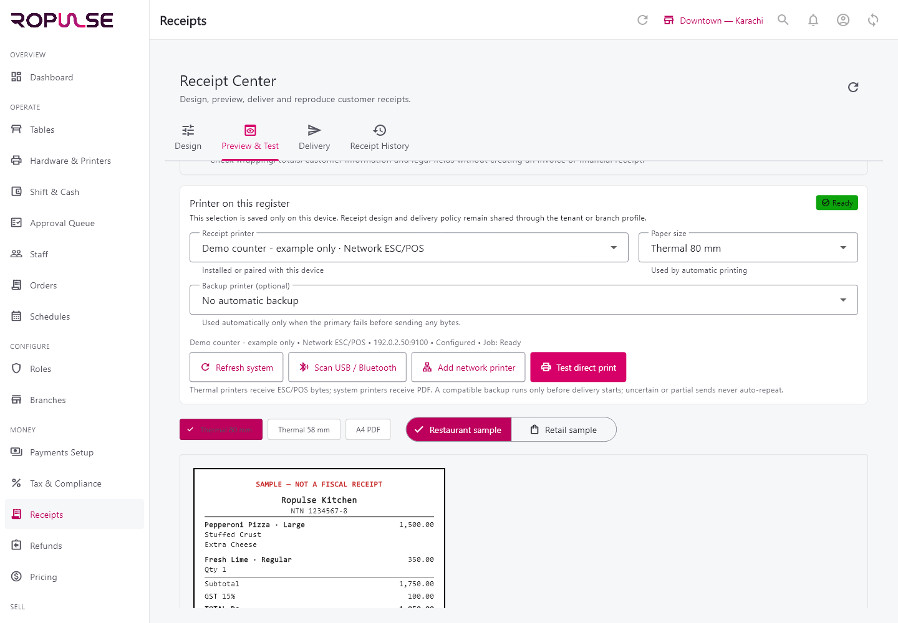

*Current app path: Receipt Center → Preview & Test → Printer on this register. This is the printer setup panel referred to in the steps. Choices are local to this installation; Ready is not proof of paper output.*

1. **Select this device’s printer.** Choose the installed or paired connection for this till. These entries are examples.
2. **Match the paper width.** Select the format matching the physical roll and inspect a test copy.
3. **Test the real output.** After installation, print an approved test and check the paper. No physical test was run for this image.

1. Install the manufacturer's driver for your printer model and Windows version if required. Follow the manufacturer's instructions on when to connect the USB cable.
2. Connect the printer directly or configure its approved network connection. Use a clear queue name such as `Counter Receipt` or `Kitchen Hot Line`.
3. Open Windows printer settings, confirm the queue is available, and print a test page. Resolve paused/offline queues, paper errors and driver failures here first.
4. Open RoPulse on this same computer and open **Receipt Center → Printer setup**. Refresh the printer list after installation.
5. Choose the intended output. A **System / PDF** destination is for rendered documents. A **Windows RAW** or other offered ESC/POS destination is used for compatible raw thermal output and KOT binding.
6. Select the matching paper format and print a RoPulse test copy. Check that the entire document fits the roll.

Do not replace a working driver with an arbitrary generic driver as a troubleshooting shortcut. If the printer appears only as System / PDF, use it for supported receipt output and have the installer establish a supported raw ESC/POS connection before using it for KOT.

### 4. Connect a network ESC/POS printer

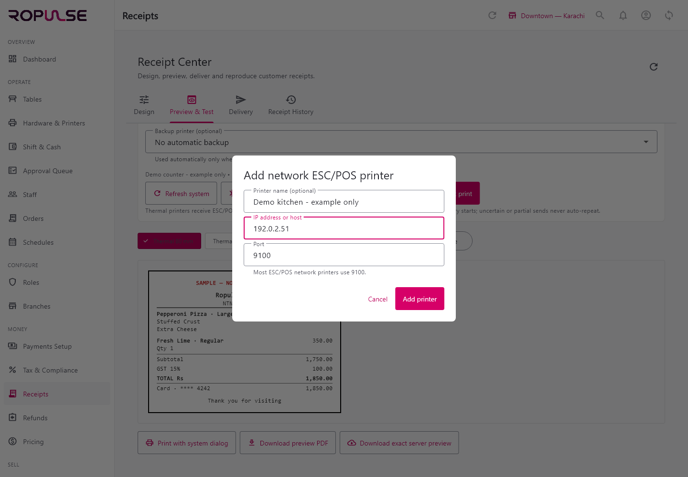

*Example configuration only. The 192.0.2.51 TEST-NET address is not a real printer address; replace it with the actual approved host and port. No connection or print was attempted.*

1. **Give the connection a clear name.** Use a name staff can recognize on this station.
2. **Enter the actual printer host.** The address shown is a documentation example. Do not copy it into your real setup.
3. **Confirm the configured port.** 9100 is the app default; use the port approved for your printer.

1. Connect the printer to the branch's approved wired or wireless network. The till or print station must have a network route to the printer; guest Wi-Fi isolation can prevent access even when both devices have internet.
2. Obtain the printer's current IP address and raw printing port from its configuration page or installer. An address such as `192.168.1.50` is only an example, not a value to copy into your setup.
3. Arrange a stable address, such as a router DHCP reservation, with the network administrator. If the address later changes, the saved connection will need updating.
4. On the printing device, open **Receipt Center → Printer setup → Add network printer**.
5. Enter a recognizable name, the printer's actual host/IP address, and its port. The app defaults to **9100**, which is common for raw network ESC/POS, but use the port configured for your printer. Do not enter the RoPulse API address, a website URL, or the router's address.
6. Add the printer, select it as needed and print a test copy. Inspect the actual output before configuring it as a kitchen destination.

Keep the printer on the approved local network. Do not make its raw printing port publicly accessible on the internet. If your network requires a firewall change, ask the administrator to allow the necessary local connection rather than disabling the firewall.

### 5. Connect USB or Bluetooth on a supported mobile device

#### Android USB

Power the printer independently if its hardware requires it. Connect it to the Android device using a compatible USB host/OTG adapter and cable. Open **Receipt Center → Printer setup** and use **Scan USB / Bluetooth** when that action is available. Accept the operating system's printer USB permission request, select the discovered USB printer, and print a test copy.

If discovery fails, check that the adapter supports USB host mode and that the cable carries data. A charging-only cable cannot provide a printer connection. Disconnecting and reconnecting may trigger a new permission request. Only grant access to the printer you intend to use.

#### Bluetooth

Turn on the printer, keep it close to the printing device and follow its manual for the correct Bluetooth/pairing mode. If the manufacturer requires operating-system pairing, complete that first. Allow the app's required Bluetooth or nearby-device permission, then use **Scan USB / Bluetooth** in printer setup. Select the matching device and print a test copy.

If another till or vendor utility is holding the connection, disconnect it there before testing. A device appearing in a scan is not proof that its printing protocol is compatible. If the app does not offer Bluetooth on the current platform, use a supported connection instead.

### 6. Choose the receipt printer and paper

In **Receipt Center → Printer setup**, select the primary printer for this installation. Choose **58 mm** or **80 mm** for the actual thermal roll, or the supported document format for system/PDF output. A paper-width choice does not change the physical roll or convert an incompatible printer into a thermal printer.

If an approved spare printer is configured, select it as the fallback and test it separately. Receipt fallback, kitchen category fallback and a device's physical KOT fallback are different settings. Naming a spare in one place does not configure all three.

Print a test copy and inspect:

- Business/branch identity and readable logo, if configured.
- Long item names, quantities, modifiers and wrapping.
- Prices, discounts, charges, tax, currency, total, payment and change.
- Required receipt identifiers and QR/barcode legibility, where configured.
- The bottom of the receipt, margins and cutter/feed behavior supported by the printer.

After the test, complete an agreed training sale and verify the saved order/invoice and physical receipt. Do not rely on a preview or a successful spooler response as the only acceptance check. Local printer choices and connection details must be checked on each installation that prints.

### 7. Prepare kitchen destinations in Backoffice

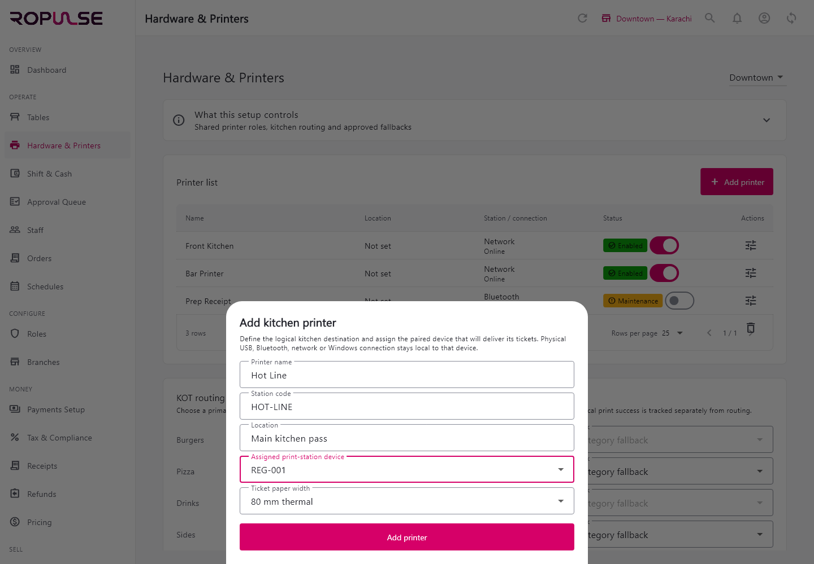

*Create a logical destination and assign its approved active station. This unsaved demonstration uses REG-001 as an example; choose your actual station. Physical connection remains local to that device.*

1. **Name the logical destination.** Use the printer name, station code and location to describe the preparation area.
2. **Assign the print-station device.** Select the actual active device that will deliver this destination’s jobs.
3. **Match ticket paper width.** Choose the physical printer’s 58 mm or 80 mm roll before saving.

A logical printer is the branch's named kitchen destination, such as **Hot Line** or **Drinks Bar**. It is a business routing record, not the USB cable, IP address or Windows queue. The physical connection is configured on the assigned device.

1. Sign in as a manager and select the correct branch. Open **Hardware & Printers**.
2. Add a logical kitchen printer. Enter **Printer name**, and useful **Station code** and **Location** values so staff can identify the destination.
3. Set **Assigned print-station device** to the approved active device that will deliver its tickets. A printer record left unassigned is not a completed station setup.
4. Set **Ticket paper width** to **58 mm thermal** or **80 mm thermal**, matching the actual printer.
5. Save and confirm the stored assignment. When editing, **Enabled for routing** is administrative availability; it is not a live printer heartbeat.

If a save reports an error after some changes were applied, refresh and inspect the stored printer and assignment before retrying. Do not assume the entire edit either succeeded or failed as one operation.

### 8. Route product categories to the kitchen

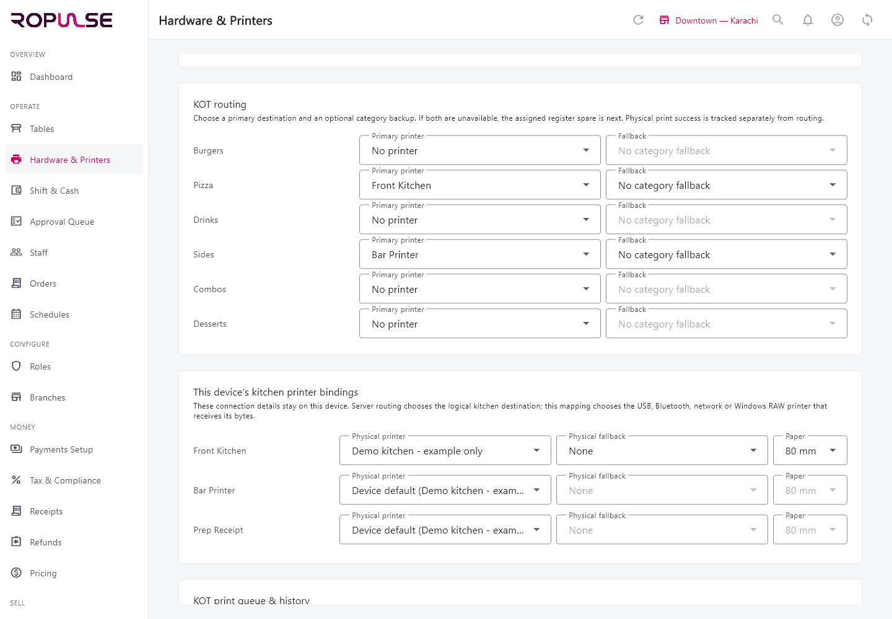

*Routing sends categories to logical destinations. Categories showing No printer in this fixture are not configured to route; complete each category required by your branch.*

1. **Choose the primary destination.** Each preparation category needs its intended logical kitchen printer.
2. **Review category fallback.** A category fallback does not configure the other station’s physical connection.
3. **Check every required category.** No printer means this example category has no destination. Review all categories before service.

Open **KOT routing** for the branch. For each category that needs preparation, select its intended logical kitchen printer and, if required, an approved category fallback. Save the routing and review it again.

For example, **Burgers → Hot Line** and **Drinks → Drinks Bar** send different parts of one order to different preparation areas. Those names are examples; use your branch's actual categories and destinations. Check the product's stored category when an item goes to an unexpected area.

Check every category that should print. A printer name alone does not create a category routing rule. Changing a category fallback also does not create a local physical connection on the fallback station.

### 9. Bind logical printers to physical printers on the station

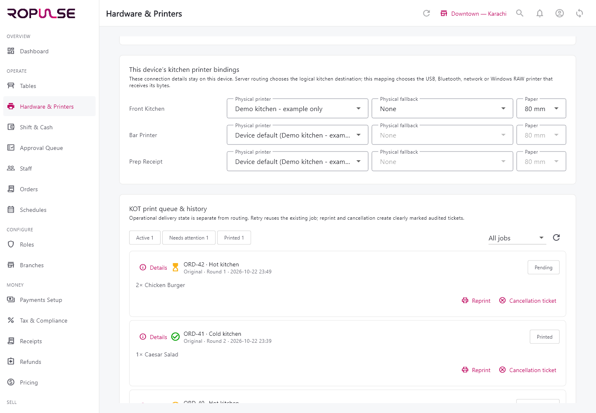

*These are device-local bindings with example network entries. A logical routing name is separate from its physical connection. System/PDF printers cannot be used for raw KOT bytes.*

1. **Choose the physical ESC/POS connection.** Do this on the assigned station, not a different manager’s computer.
2. **Set an approved local fallback.** This fallback belongs to the physical binding and differs from category fallback.
3. **Check the local paper format.** Save the real thermal width for this station’s connection.

Do this on the assigned device after adding or discovering its printers in **Receipt Center → Printer setup**.

1. Open **Hardware & Printers → This device's kitchen printer bindings** with the required permission.
2. Find the logical destination, for example **Hot Line**.
3. Choose its **Physical printer** from the compatible local ESC/POS connections.
4. Set **Physical fallback** if this station has an approved alternative, and choose the actual **Paper** width.
5. Confirm the settings are saved. Repeat for every logical printer served by this device.

**System / PDF printers cannot print KOT bytes.** Use an offered USB ESC/POS, Bluetooth ESC/POS, Network ESC/POS or compatible Windows RAW destination. A virtual printer, when shown in a development build, is a simulator and produces no physical kitchen ticket.

The **Device default** choice uses this installation's selected printer. For a station serving several preparation areas, explicit bindings make the destination clearer and avoid later receipt-default changes redirecting kitchen output. Ensure any default used for KOT is itself a compatible ESC/POS destination.

Printer bindings stay on the device. Configuring them on a different laptop does not configure this station. If you reinstall the app, replace the device or change its printer connection, recheck the binding and permissions before service.

The station needs its approved RoPulse device identity, access to its assigned jobs and the appropriate print-station permission. A cashier's device-local job access does not grant branch-wide hardware management. Keep the supported station runtime available during service; do not assume a closed app, sleeping device or arbitrary browser tab continues to process jobs. If RoPulse says durable KOT delivery is waiting for backend activation, ask your administrator to complete the deployment rather than repeatedly sending the order.

### 10. Send an order and confirm the kitchen result

1. Create a clearly identified training order with an item from each routed category. Include a modifier, note and quantity that can be checked on paper.
2. Select the intended course where your service uses courses. Use the send control for unsent items or **Send courses to kitchen** for the selected course round.
3. Confirm that each intended preparation area receives the right items with the correct order/table or token, quantities, modifiers, notes and course information.
4. Open the available KOT status/history and compare its job/order/round references with the paper. Verify both the application status and the physical destination.
5. Add another item and send a new round. Confirm the new item reaches the kitchen and earlier items are not unintentionally sent for preparation again.

**Settle** sends remaining unsent items before opening checkout in the current app flow. That does not mean payment has already been taken, or that the printer has physically produced paper. If kitchen sending fails and checkout is blocked, resolve the reported sending problem and inspect the order before trying again.

Do not use repeated kitchen sends as a printer recovery technique. Once an item has been sent, investigate its existing KOT job. A reprint is an additional copy of a ticket and must be communicated to kitchen staff to prevent duplicate preparation.

### 11. Read KOT status and recover safely

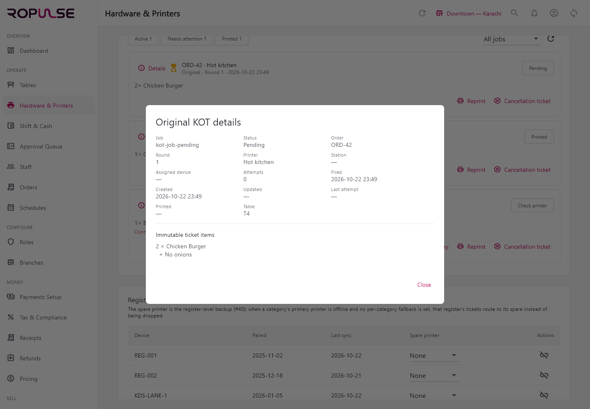

*Pending sample job: no station/device or print attempt is recorded here. Investigate those fields and the physical output before retrying; this is not a completed installation.*

1. **Keep the job and order references.** Use these references when matching the kitchen paper or contacting support.
2. **Check assignment and attempts.** This pending example has no assigned device or attempts. Resolve the actual station setup.
3. **Compare the immutable ticket items.** Match quantities, modifiers, notes and the round before creating another copy.

Managers can inspect **KOT print queue & history**; ordinary devices may have a narrower status view. Use the available **Details** action to check the job, order, round, printer, assigned device, attempts and last-attempt information.

| Status shown | Meaning and next action |
| --- | --- |
| Routed / Pending | A job exists and awaits processing. Check assignment, station availability, local binding and connectivity. |
| Claimed / Printing | A station has taken responsibility or is sending the job. Check that station before creating another copy. |
| Printed | The transport/station reported a successful handoff. Inspect paper during installation or when staff report a missing ticket; not every printer can confirm physical output. |
| Not sent | Delivery failed before a successful send. Correct the connection problem and use the authorized retry action. |
| Check printer | Delivery is uncertain; some or all bytes may have arrived. Inspect the printer and ask the kitchen before choosing an authorized retry. |
| Failed | The job needs investigation. Read its details/error and involve a manager or support. |
| Unknown | The client cannot interpret the status. Record the job reference and seek support rather than assuming it printed. |

Fallback is safe automatically only when the system knows the original destination could not have received the output. An uncertain send can produce paper despite an error; a second send may duplicate it. After checking the physical output, use the permitted **Retry** or **Reprint** action and supply a reason when requested.

A **Cancellation ticket** tells the kitchen which previously sent items should no longer be prepared. Use it when authorized and appropriate, and confirm the kitchen has seen it. Creating a cancellation ticket does not itself void an order item, refund a payment or reverse the sale; perform those business actions separately through the order's permitted workflow.

### 12. Print a pre-receipt or another copy of a receipt

For an open order, use the header **Pre-receipt** action. The current app opens an **UNPAID** provisional bill preview with **Print** and **Save PDF**. Review it before handing it to a customer. Those actions do not settle the order. This preview uses system document output; it does not configure a raw KOT printer connection.

For a completed sale, find the original document in the available receipt/order history and use its authorized print or reprint action. Confirm the original invoice and payment first. Never settle the order again merely to obtain paper. Receipt delivery channels depend on branch configuration; do not assume SMS or WhatsApp delivery exists because a printer is configured.

### 13. Troubleshooting

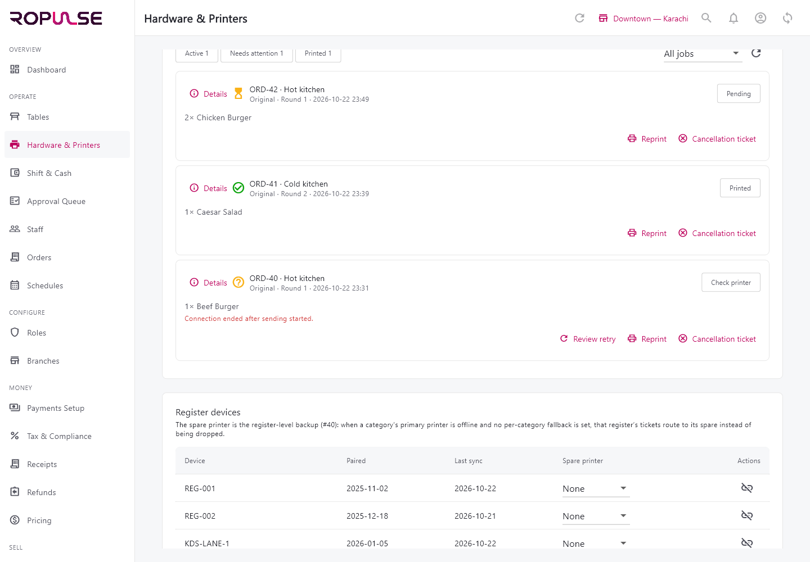

*Check printer means an uncertain send in this example. Inspect the existing job and ask the kitchen before an authorized retry. Reprint and cancellation create additional ticket records; they do not take or reverse a payment.*

1. **Open the original job.** Details identifies the order, round, destination and attempts.
2. **Recognize uncertain delivery.** Check printer can mean bytes already arrived. Inspect the printer and speak to kitchen staff.
3. **Review before retrying.** Use an authorized retry on the existing job after checking output. Do not send the order repeatedly.

| Problem | What to check |
| --- | --- |
| Printer not listed | Power/cable, driver or supported transport, operating-system discovery, permissions, and a refreshed RoPulse list. For network ESC/POS, add the actual address instead of expecting USB/Bluetooth scan to find it. |
| Windows test page fails | Fix the queue, driver, paper or connection first. RoPulse cannot repair a printer the operating system cannot use. |
| Network printer added but no paper | Check the printer's current IP/port, routing from this station, network isolation and compatible raw ESC/POS mode. Internet access alone does not prove local reachability. |
| USB printer not found on Android | Check USB host/OTG support, data cable, printer power and the USB permission request. |
| Bluetooth connects but cannot print | Check the exact model/protocol, permissions and whether another device owns the connection. Pairing alone does not prove ESC/POS compatibility. |
| Blank receipt | Run the printer's self-test and check thermal paper direction before editing receipt templates. |
| Cut-off text or excessive blank paper | Match 58/80 mm output and driver paper settings; inspect scaling/margins for system printing. Test a long receipt. |
| Garbled symbols or raw commands on paper | Check model compatibility, transport choice and driver/raw mode. An office/PDF destination must not be used as a raw KOT printer. |
| Receipt prints but no KOT | Check category routing, logical printer enabled state, assigned station, local ESC/POS binding, station permissions and KOT capability/job status. |
| Ticket goes to the wrong area | Check the item's category, category routing and the assigned station's physical binding; the display name alone is not sufficient. |
| Ticket prints twice | Inspect job IDs and attempt history, reprints, uncertain retries and physical fallback. Do not keep retrying while investigating. |
| Printer says ready but job remains pending | Enabled/configured is not a live delivery guarantee. Check the assigned station, runtime, authenticated device and job details. |
| Print fails after payment | Verify the original paid sale and retrieve its receipt. Repair output and reprint; do not take payment again. |
| Cash drawer does not open | Check whether the released integration and printer support drawer control, the drawer's approved connection and its own setup. Receipt printing alone does not guarantee drawer operation. |

If a problem persists, record the branch, station/device code, app version, operating system, exact printer model, connection type, order/invoice/job reference, time and displayed error. Include whether any paper appeared and whether the printer's self-test or operating-system test succeeded. Share those details with support; do not include passwords, tokens or customer payment-card details.

### 14. Daily opening and installation acceptance

Before service, check power, paper, spare rolls, covers, cables and station availability. Run the approved test on each receipt and kitchen destination after installation or any connection change. Confirm that pending/uncertain jobs from the previous service have been investigated before triggering retries.

The installer and branch manager should sign off these checks before relying on the setup:

- The exact printer model and connection were tested on the actual released app and station.
- Customer receipts fit the paper and show the correct totals and identifiers.
- Each routed category reaches the intended kitchen destination.
- Modifiers, notes, courses and a second round appear correctly.
- The approved fallback has been tested without an uncertain duplicate send.
- Staff can find job status and understand the difference between retry, reprint and sending a new round.
- A lost connection or paper fault can be recovered without creating another payment or duplicate preparation instruction.

This guide describes the current app's setup and recovery workflow. It does not certify a printer model, confirm a physical installation, or guarantee offline/background delivery for every device.

### Other supported peripherals

A keyboard-wedge barcode scanner behaves like typed input in the appropriate scan/search field. Test a known product and repeated scans, confirming quantities and input focus before service.

Biometric/card login requires a supported reader and the corresponding staff enrollment and access setup. Use the approved fallback login if unavailable; do not share another person's PIN. For a customer display, verify the released display mode, actual screen and configuration using non-sensitive training data. A connected monitor is not automatically a configured customer display.

For related service workflows, see [Restaurant service and the kitchen](user-guide/06-restaurant-service-and-kitchen.md). For connectivity recovery, see [Connectivity and troubleshooting](user-guide/12-connectivity-and-troubleshooting.md).

---

## Connectivity & troubleshooting

Draft · confirm against the supported release, role and platform.

Use this guide when the result of an action is unclear or the app cannot load
what you need. Begin with the selected branch, your account, the displayed
message and the original order/reference. A calm check of the existing record
is safer than starting another financial operation to see whether it works.

### Check the kind of problem

If many pages fail, check the device's internet connection and whether other
authorized devices have the same problem. If only one action fails, read its
message: it may concern permission, missing setup, input validation, a changed
order state or a server issue rather than general connectivity.

Backoffice needs an online connection for authoritative administration. A page
that was visible before losing connection is not proof that edits can still
be saved. Keep the form's context and use the supported retry/reload path;
verify the stored result after reconnection rather than assuming the click
saved it.

### If a product or payment method is missing

*One place to investigate missing items: confirm the category, active state and intended sales channel, then follow the checks below.*

1. **Choose a setup tab.** Categories organize the catalog; Products and Modifiers manage their own records.
2. **Add a category.** Create a clear category before organizing its products.
3. **Check availability.** Read the sales-channel labels and active switch for the intended category.

Confirm the branch and order type first. Ask the manager to check active status,
branch visibility, effective pricing and published layout for a missing product.
For a missing payment method, check business-wide enablement and the selected
branch policy, supported currency and any required setup. A missing method
cannot be restored by entering its name as a different method's reference.

If the app shows **not available** or a permissions error, collect that exact
message. Do not assume every unavailable feature can be unlocked by paying
more: role, profile, release support and service readiness can also apply.

### If a save or payment response is uncertain

For a settings save, keep the form and inspect the authoritative record using
its supported reload/recovery action. A multi-step setup can be partially saved.
Check which object already exists before creating another one.

For a sale, settlement, refund, gift-card action or repeat-order confirmation,
preserve the original order/reference and avoid a new duplicate request. Ask a
manager to inspect its order/payment/history state and use the original
recovery action. A slow screen does not prove the server rejected the payment.
Do not take the customer's money again until the original outcome is known.

For printing, distinguish the recorded sale from the physical output. Inspect
the original job and printer, then use an authorized reprint if appropriate.
Starting a second invoice is not a print-recovery method.

### Offline Register use, where explicitly enabled

Use offline operation only on a released native Register/device that onboarding
has confirmed supports it. Initial installation, staff preparation and required
data/authorization setup must be completed while online. The management website
is not an offline Register, and a cached page does not establish offline sales
support.

Before relying on offline use, check the readiness information provided for
your release: branch/device identity, cached product/price information,
authorization/renewal deadline, invoice capacity and pending/conflict status.
Ask the manager to complete any missing prerequisite while connected. A valid
software subscription alone does not prepare an unconfigured device for an
internet outage.

When offline use is enabled, only perform the actions that release permits.
External payment verification, redemption and other sensitive operations may
still need a connection or additional authorization. Do not assume every menu
button is allowed offline. If the app says to reconnect or refuses a new
operation because a deadline/numbering prerequisite is exhausted, follow the
displayed recovery instructions rather than changing the device clock.

On reconnect, inspect pending work and wait for confirmation that it has
converged with the business's authoritative records. A local/edge acceptance
message may still mean a cloud upload is pending. Escalate rejected/conflicting
items with their references. Do not manually enter those sales again unless
support has confirmed an authorized resolution.

### Protect records during device trouble

Do not clear application storage, delete a local database, reset a device or
uninstall the app while it may hold pending business activity. Such actions can
remove unsynchronized records or the protected device identity needed for
recovery. An ordinary staff logout and a device unpair/replacement are different
operations; follow the authorized support procedure for the latter.

If a device is lost, damaged or replaced, inform the owner and support promptly.
They should check its access, remaining local/replicated activity and controlled
replacement process. A cloud copy cannot contain a sale that never reached it
or another approved recovery destination. Keep physical incident notes without
inventing a replacement invoice number.

### Send a useful support request

Include the business/branch, app version, device/OS, approximate local time and
timezone, exact error text, task attempted, original order/invoice/reference,
and whether the operation may already have succeeded. Explain which safe
checks you performed. A screenshot can help if it excludes unnecessary customer
and payment information.

Never send passwords, PINs, private keys, card security codes or a full customer
export. Use the actual support contact provided by the business/onboarding
team. For an urgent financial uncertainty, tell the manager before retrying
so the customer and other staff receive consistent instructions.

---

## Subscription & support

Draft · confirm against the supported release, role and platform.

This guide is for the person purchasing or managing RoPulse for a business.
Your confirmed subscription order determines the package, branch and terminal
quantities, billing period, add-ons and terms. Keep your subscription invoices
and receipts in the business's records. Money paid for RoPulse software is
separate from the customer payments your staff record in the Register.

### Your account and purchase

Create or sign in to your RoPulse owner account on the website before buying.
Verify your email, select the intended business and review the package/cycle,
outlet and terminal quantities, add-ons, taxes and total. An existing owner
should select the existing business for renewal or changes rather than create
a duplicate workspace. The account also provides billing status, invoices,
renewal controls and cancellation.

The website and Backoffice use the shared RoPulse identity for the authorized
business. A business shopper in your customer directory is not a subscription
owner account. Ordinary cashiers do not gain billing-owner rights merely by
being able to take a sale.

Read the [website account and billing guide](user-guide/15-website-account-and-billing.md)
for the detailed signup, purchase and cancellation steps. These new portal
instructions apply when the automated website billing release is enabled.
Do not use a draft payment page or a payment number from an unofficial message.

### Payment options and activation

Choose the payment route shown on your subscription checkout:

- **Safepay automatic renewal:** Complete the supported hosted payment and
  recurring authorization. Review the first charge, frequency, next renewal
  and cancellation information. Scheduled charges continue until cancelled or
  stopped by a payment/authorization issue.
- **1Bill invoice payment:** Obtain the registered payment number in your
  account and pay it through a supported banking channel. Check the biller,
  amount and due date before approving payment. The website confirms the result
  and activates/renews the subscription automatically after provider verification.

For ordinary 1Bill collection, the next cycle produces another bill that you
authorize through your channel. Automatic invoice processing is different from
permission to debit your bank account automatically. The website will identify
any separately supported mandate arrangement explicitly.

No screenshot or staff payment approval is needed for the normal subscription
flow. While the provider result is pending, check the invoice status rather
than paying again. A browser return page alone is not the final payment record.
After confirmed first payment, account status shows business setup/provisioning
progress and then the next onboarding steps. A technical setup delay does not
mean that a successful payment should be repeated.

### What the subscription covers

Review the approved offer for included features, branches, terminal slots and
optional services. Backoffice access does not consume a Register terminal slot
under the commercial design. Additional Register devices can require additional
slots, and hardware/onboarding/metered services may have separate terms.

After purchase, complete business/branch setup and prepare the supported
Register devices with the supplied onboarding process. Buying software does
not connect printers, create staff credentials or prepare offline data by
itself. Use the released app for the device and complete its readiness checks.

### Renewal, cancellation and payment problems

In your website account, review the actual billing mode, next amount/date and
paid-through date. Safepay renewal requires a usable authorization/instrument.
For 1Bill, pay the current renewal bill by its due date; the account confirms
the resulting service period after verification. Do not pay an old or superseded
number to guess which invoice it might cover.

Use **Cancel renewal** to stop future renewal. Read the displayed service-end
date and confirm. A pending provider response is shown as pending until the
stop is confirmed. Already-paid access ordinarily lasts through its paid-through
date; cancellation and a refund are separate actions. If provider cancellation
requires a new subscription to restart later, follow the new consent/checkout
flow instead of assuming renewal will resume by itself.

If a renewal fails, use the account's payment recovery/update options and read
its status/deadline. The commercial late-payment policy and a Register's offline
authorization deadline have different purposes. A temporarily usable device
does not mean an unpaid subscription invoice has disappeared.

Plan changes and switching between Safepay and 1Bill use the account's supported
change workflow. Do not create a second active subscription or pay a 1Bill
renewal while an automatic collection for that same invoice is still active.
Check confirmation of the effective route and upcoming period.

### Contact support

For billing questions, provide the business, subscription invoice/reference,
payment route and displayed state through the actual support channel. If money
may already have been paid, explain that before retrying. Never provide card
security codes, account passwords or staff PINs.

For app/setup problems, provide the branch, app version/device and original
order references. Before replacing or reinstalling a Register, check pending
activity with support. Read the [connection and recovery guide](user-guide/12-connectivity-and-troubleshooting.md)
before clearing storage or resetting a device that may hold unsynchronized sales.

---

## Orders & administration

Draft · confirm against the supported release, role and platform.

This guide is for managers investigating activity or maintaining the business's
administrative settings. Use an account with the required permissions. Before
changing a record, confirm its branch and original reference; several orders
can have similar customers, tables and totals.

### Find an existing order

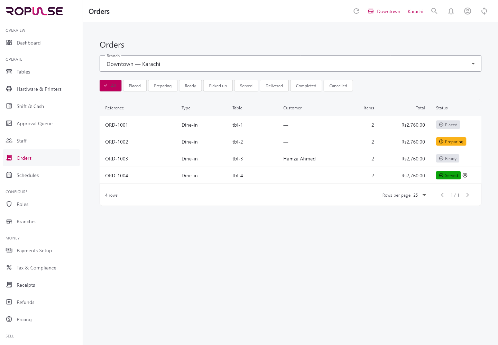

*Search the original order in the selected branch. These sample records do not establish live endpoint availability for every installed release.*

1. **Choose the branch and status.** Narrow the list to the relevant branch and order state.
2. **Follow the original reference.** Match the order reference and details before investigating or changing an order.

Open **Orders**, check the branch and use the available status/context filters.
Read the reference, type, table/customer, item count, amount and status to find
the intended order. Open its detail rather than acting on an amount alone.
Where global search is available in the header, use it as a shortcut to a
supported result, then confirm the destination record and branch.

Order detail lets an authorized user inspect the items and supported actions
for that state. Where **Add item**, line editing, table movement or status
advancement is offered, confirm the business event before using it. A status
change should reflect what happened operationally; it is not a way to record
a missing customer payment.

Review **Status history** to see the available sequence of changes and their
times. Compare that history with payments and receipts when investigating a
complaint. A held order can still be open, and a preparation status does not
necessarily prove the customer has settled its bill.

If the wrong order was opened, return to the list without making a speculative
edit. If the record changed while you were working, reload the current state
and reconsider the intended action. Do not force an older assumption over a
newer payment or approval result.

### Act on an approval request

Open **Approval Queue** or the specialist approval area linked by the request.
Read the originating staff member, branch, order, reason and requested change.
For a refund, confirm the original sale/payment and amount. For a price/void
request, confirm the affected item and the business's policy.

Approve or reject through the provided control once. Wait for the saved result
and let the requesting staff member continue through their original workflow.
Some requests authorize a subsequent action instead of performing that action
automatically. Check the resulting order/refund state before telling the
customer that money has been returned or a bill changed.

If a request has already been processed, inspect the recorded decision. A second
approval attempt should not be used to create another financial event. When
you deny a request, give an accurate reason through the supported business
process so the requester knows the permitted next step.

### Review notifications without assuming completion

The notification indicator/inbox, where enabled, can point to relevant activity
or a request requiring attention. Open the linked record and inspect its current
state: the notification may refer to an event that another manager has already
resolved. Reading a notification does not by itself approve, settle or reverse
the underlying operation.

Only use notification settings that the released app actually provides. The
existence of an inbox does not imply a complete tenant-wide notification setup
screen or every external delivery channel. Raise configuration needs through
the business's onboarding/support contact when a required setting is absent.

### Manage staff meals

Where the staff-meals module is enabled for an authorized account, review its
existing policies before creating another. A policy should describe the
business's actual employee-meal arrangement. Use **New policy**, complete the
supported fields, create it and inspect the stored result.

To record a meal, select the correct policy and staff member and enter the
information required by the form. Confirm the transaction and check the
recorded meal list. A staff-meal record is a distinct operational event; do
not assume it replaces every customer-order, stock or payroll process unless
the business's implemented workflow explicitly says so.

### Use Settings, System Settings and personal account tools

**Settings** provides the branch/business configuration available to your role.
**System Settings** exposes the supported business/system information and
readiness tools. Read each card's explanation and scope before editing. A
business name used on a receipt, branch-specific service preference, device
printer choice and personal theme preference affect different things.

Save settings deliberately and check the confirmation. If concurrent changes
or unsaved-work prompts appear, compare the stored version and your intended
changes before replacing anything. An informational readiness card is useful
for diagnosis; it is not permission to change infrastructure or delete data.

Use **Profile** and **Change password** for your own account. Use the supported
theme preference if you want to change how the app appears on the device; that
is separate from publishing a branch's Register layout. Use **Support** to
identify the version and configured contact information.

### Keep an investigation traceable

For any unresolved issue, record the original order/invoice/request reference,
branch, time, staff context, displayed state and intended result. Compare the
order, payment, receipt, shift and audit views where your role allows them.
Ask support to help recover the same event rather than constructing a new
event with a similar value. This preserves the history needed to explain the
result to the customer and the business owner.

---

## Website account & billing

Draft · confirm against the supported release, role and platform.

This guide is for the business owner or a person authorized to manage its
RoPulse subscription. It describes the planned automated account/billing release;
use these steps when that release is enabled on the official website. Public
product pages and documentation can be read without an account. Purchasing and
private subscription records require your verified account.

### Create or recover your account

1. Choose **Create account** from the official website or continue from the
   package you want to purchase. If you already own/manage a RoPulse business,
   choose **Sign in** instead.
2. Enter your real contact details and complete the offered credential setup.
   Use an email address you control and can continue to access for billing and
   recovery. Keep its credentials private.
3. Open the email-verification message and complete the expiring verification
   step. If it expires, request another through the website; do not create a
   second account merely to receive another link.
4. Enter/select the business and billing details requested. Review existing
   business memberships before creating a new workspace purchase.
5. Open your account dashboard and check the business selected before paying
   or changing a subscription.

If you forget the password, use the official recovery flow. If an existing
business is missing, ask support to check your ownership/membership rather than
creating another paid business with the same name. Access to an email address
or a similarly named business must not be used to claim another person's account.

### Review a subscription order

Choose the package and billing period, then review the outlet count, included
and additional Register devices, add-ons and any one-time services. Check the
currency, discounts, taxes and total. Read the subscription/refund/cancellation
terms before accepting. The amount shown for the current purchase and the next
renewal should be understandable before authorizing payment.

Your account's invoice is for the software subscription. It is not one of the
restaurant/retail invoices you issue to customers. Billing permission also does
not automatically give staff permission to edit products, refund a shopper or
operate another branch.

### Pay with Safepay and enable automatic renewal

Select the Safepay recurring option and review the displayed authorization,
amount and schedule. Continue to the supported provider-hosted payment screen
and complete its checks. Enter payment credentials only through that official
flow, not in a support conversation or document upload.

After returning, allow the website to retrieve the authoritative status. If it
says **Verifying** or **Payment pending**, return to the existing invoice/status
page rather than starting another purchase. On confirmation, check the paid
invoice, subscription and business setup status.

The account displays the next renewal and paid-through date. Supported recurring
charges run according to the authorization until you cancel or a payment or
authorization problem stops them. Keep the authorized payment method current
through the account's provider-supported update flow. Do not assume automatic
renewal succeeded if the invoice shows a failed or outstanding payment.

### Pay through 1Bill

1. Select **1Bill** for the current subscription invoice.
2. Wait for the website to generate/recover its registered payment number.
   Copy the complete number and read the amount, currency, due date and biller.
3. In a banking/payment channel that supports this bill, open its applicable
   1Bill invoice-payment option and enter the number. Channel labels can differ.
4. Review the biller/beneficiary identity and amount returned by the channel.
   If they do not match the invoice, stop and contact support before paying.
5. Authorize the payment through that channel, retain its confirmation and
   return to your existing RoPulse invoice/status page.
6. Wait for automatic provider verification. The page shows the confirmed
   payment and applies activation/renewal without a staff approval step.

Use the number for the invoice shown in your account. Do not reuse an expired
or superseded reference without checking the current bill, and do not generate
a second purchase because a provider notification is delayed. If the bank says
payment succeeded while the website is still verifying, provide the existing
invoice and bank transaction reference to support instead of paying again.

Ordinary 1Bill renewal issues a new payable bill for the next service period.
You approve that payment in the supported channel; the website then processes
it automatically. It is not automatically a standing bank-debit authorization.
Read the actual account instructions if a separately enabled mandate option
is offered in a later release.

### Find invoices, receipts and service dates

Open **Account → Invoices** for subscription documents and payment status.
Select the intended business and invoice; inspect the billing period, amount,
currency and transaction result. Download the supported receipt/invoice and
keep it with the business's records. Read refund/credit entries separately from
the original payment.

Under **Subscription**, check the active package/quantities, billing route,
paid-through date and next renewal action. A new business can show provisioning
after payment while its workspace is being prepared. That state is different
from a rejected payment and should not trigger another payment attempt.

### Cancel future renewal

Open **Account → Subscription → Cancel renewal**. Review the next charge and
the date through which access has already been paid. Confirm using the offered
account verification step. Keep the cancellation reference/confirmation.

For Safepay, the account must confirm that future provider charging has stopped.
If confirmation is pending, the page says so and the system reconciles it;
signing out or deleting the app does not cancel a subscription. For 1Bill, the
system stops future renewal bill creation and handles unpaid bills according
to the stated cancellation cutoff.

Ordinary cancellation retains already-paid service through the displayed end
date. It does not automatically refund the last charge or delete business sales
history. Refund and data-export requests follow their separate published
processes. If you later restart a provider-cancelled subscription, complete
the offered re-subscription/consent process; do not assume an old authorization
will restart automatically.

### Change billing route or resolve an issue

Use the supported **Change payment method/billing route** action, review its
effective period and wait for confirmation. Do not create a new subscription
to switch from automatic Safepay collection to 1Bill: that could leave two
collection paths targeting the same renewal. A pending switch should remain
visible until the system confirms it is safe.

For a failed renewal, inspect the current invoice and use the offered update/
payment-recovery action. Contact support when the provider result and account
state disagree, giving references and the displayed message. Never share your
password, PIN, full payment credentials or card security code. For operational
app issues, use the [troubleshooting guide](user-guide/12-connectivity-and-troubleshooting.md).

